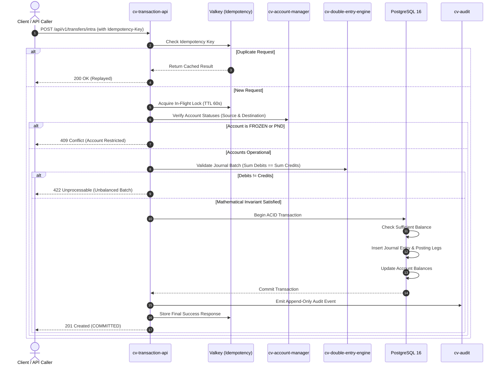

# CoreVault V1 System Architecture

This document provides a comprehensive architectural blueprint of **CoreVault**, an enterprise-grade Core Banking Application (CBA) engineered in **Rust**.

---

## 🏛️ 1. The Open Core Architecture Model

CoreVault strictly divides generic, mathematically verifiable core banking primitives from commercial, country-specific payment switches and monetization layers:

```
┌────────────────────────────────────────────────────────────────────────┐
│                        COREVAULT MONOLITH                              │
├────────────────────────────────────────────────────────────────────────┤
│  PUBLIC OPEN-SOURCE CORE (Apache 2.0 / MIT)                            │
│  - Mathematical Double-Entry Engine (Zero floating point, rust_decimal)│
│  - Account Lifecycle & State Machine (ACTIVE, PND, FROZEN, CLOSED)     │
│  - Liens & Balance Hold Logic                                          │
│  - NUBAN Mod-10 Algorithm & Account Generation                         │
│  - Multi-Country Platformization TOML Engine (cv-platform-config-parser)│
│  - Immutable Audit Event Sink (cv-audit)                               │
│  - Staff IAM & Argon2id Password Hashing (cv-auth)                     │
│  - Core REST API Gateway & Routing (cv-transaction-api)                │
├────────────────────────────────────────────────────────────────────────┤
│  PRIVATE ENTERPRISE RAILS (Closed-Source Extension Crates)             │
│  - NIBSS NIP Instant Payment Switch (ISO-8583 Bridge)                  │
│  - P2P Escrow Engine & Milestone Approvals                             │
│  - Undo Transfer Window (15-30s delay queues in Valkey)                │
│  - Smart AI Transaction Tagging & Financial Categorization             │
│  - Automated Regulatory Reporting (CBN, NFIU, SAR XML Generators)      │
└────────────────────────────────────────────────────────────────────────┘
```

The extension boundary between the public core and private enterprise crates is governed by typed Rust traits defined in `cv-types`:
* `PaymentRailAdapter`: Generic outward and inward payment rail protocol.
* `ComplianceReporter`: Regulatory transaction threshold filtering and report generation.

---

## 🔄 2. End-to-End Transaction Lifecycle

Every financial movement in CoreVault follows a rigorous, multi-stage pipeline designed for mathematical correctness, zero data loss, and sub-millisecond execution:



---

## 📦 3. Workspace Crate Breakdown

| Crate | Dependencies | Responsibility |
| :--- | :--- | :--- |
| **`cv-types`** | `rust_decimal`, `serde`, `uuid`, `chrono` | Domain types (`Money`, `Currency`, `AccountId`, `TransactionId`), errors, and enterprise extension traits (`PaymentRailAdapter`, `ComplianceReporter`). |
| **`cv-double-entry-engine`** | `cv-types` | Invariant enforcement: $\sum \text{Debits} == \sum \text{Credits}$ per currency, strictly positive posting legs. |
| **`cv-nuban-validator`** | None | CBN Mod-10 algorithm for Nigerian Uniform Bank Account Numbers, check-digit computation, and prefix validation. |
| **`cv-account-manager`** | `cv-types`, `cv-nuban-validator` | Account lifecycle state transitions (`PENDING` $\rightarrow$ `ACTIVE` $\rightleftharpoons$ `POST_NO_DEBIT` $\rightleftharpoons$ `FROZEN`), lien and hold balances. |
| **`cv-platform-config-parser`**| `serde`, `toml` | Parses multi-country configuration profiles (`NG.toml`, `GB.toml`), KYC limits, and tax rules. |
| **`cv-audit`** | `async-trait`, `serde`, `chrono`, `uuid` | Tamper-evident, chronological audit logging sink. |
| **`cv-auth`** | `argon2`, `jsonwebtoken`, `uuid`, `chrono` | Staff authentication, password hashing with Argon2id, and JWT issuance/validation. |
| **`cv-transaction-api`** | `axum`, `tokio`, `tower-http`, all crates | Axum web router, controllers, request parsing, and error transformation. |
| **`corevault` (Binary)** | `cv-transaction-api`, `tracing`, `tokio` | Monolith bootstrap, signal handlers, configuration loading, and server startup. |

---

## 🗄️ 4. Database Schema & Ledger Design

The PostgreSQL 16 database (`migrations/20261022000000_init_corevault_schema.sql`) implements a partitioned, immutable ledger architecture:

### Key Tables
1. **`cv_customers`**: Master customer profile, KYC tier level (`TIER_1`, `TIER_2`, `TIER_3`), national identity numbers (BVN, NIN).
2. **`cv_accounts`**: Financial accounts linked to customers, storing current state (`ACTIVE`, `PND`, `FROZEN`), ledger balance, and hold balance.
3. **`cv_chart_of_accounts`**: General Ledger (GL) hierarchy categorizing Assets (`1000-1999`), Liabilities (`2000-2999`), Equity (`3000-3999`), Revenue (`4000-4999`), and Expenses (`5000-5999`).
4. **`cv_ledger_journal_entries`**: Master transaction records containing transaction reference, currency, value date, and posting status. Partitioned by range on `created_at`.
5. **`cv_ledger_postings`**: Immutable posting legs containing debit/credit indicators, amount, account reference, and GL code.
6. **`cv_account_holds`**: Active lien records tracking collateral holds, pending authorizations, or court-mandated freezes.
7. **`cv_audit_log`**: Append-only log of administrative and financial operations.

### Mathematical Integrity Invariant
Every committed journal entry satisfies:
```sql
SELECT journal_id, currency,
       SUM(CASE WHEN entry_type = 'DEBIT' THEN amount ELSE -amount END) AS net_balance
FROM cv_ledger_postings
GROUP BY journal_id, currency
HAVING SUM(CASE WHEN entry_type = 'DEBIT' THEN amount ELSE -amount END) <> 0;
-- Returns 0 rows in CoreVault.
```

---

## ⚡ 5. Performance & OCI Free Tier Optimization

CoreVault is specifically engineered to achieve optimal throughput on the **Oracle Cloud Infrastructure (OCI) Always Free Tier (ARM Ampere A1)**:

* **Resource Footprint:** 4 OCPU ARM Ampere cores + 24 GB RAM.
* **Rust Binary Size:** Stripped release binary $< 25$ MB with zero runtime garbage collection.
* **Database Pool:** Optimized `sqlx::PgPool` with 20 connections, zero query allocation overhead, and parameterized statements.
* **Valkey Caching:** Sub-millisecond idempotency deduplication and session token blacklisting.
* **Throughput Target:** $> 5,000$ double-entry transfers per second with $p99 < 8\text{ms}$.
