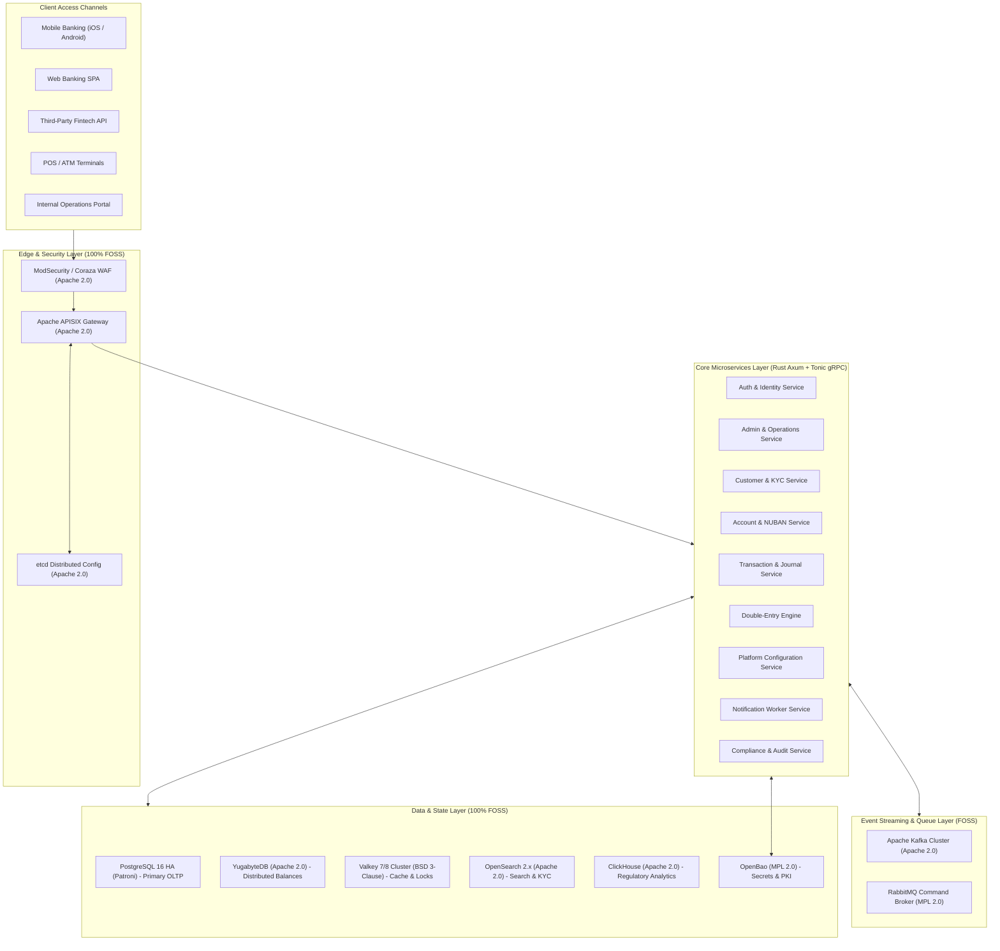
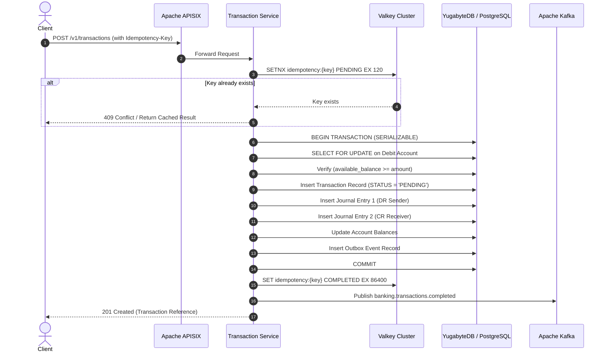
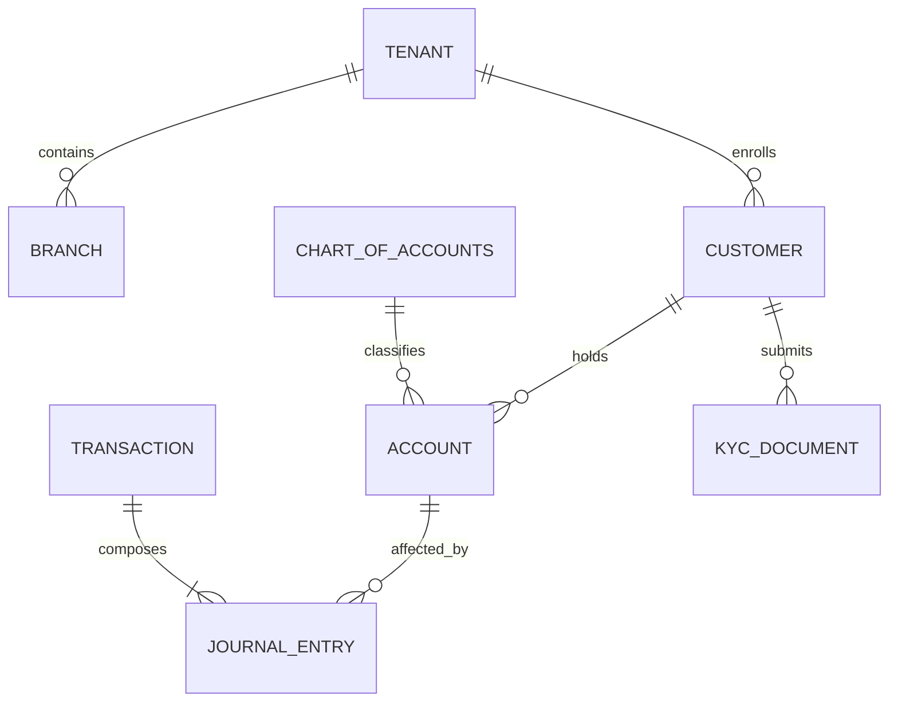

# Product Requirements Document (PRD)
# CoreVault — 100% Free & Open-Source Core Banking Platform in Rust

> **Version:** 2.0.0 (100% FOSS & Self-Hostable Edition)  
> **Date:** October 2026  
> **Status:** Approved Architecture Draft  
> **Target Market:** Nigeria (CBN & NIBSS Compliant) with Multi-Country Platformization  
> **File:** `docs/PRD-2.md`

---

## Table of Contents

1. [Executive Summary](#1-executive-summary)
2. [100% Free & Open-Source (FOSS) Audit & Tool Constraints](#2-100-free--open-source-foss-audit--tool-constraints)
3. [System Architecture Overview](#3-system-architecture-overview)
4. [Technology Stack & Justification](#4-technology-stack--justification)
5. [Domain Modules](#5-domain-modules)
   - 5.1 [Admin Module](#51-admin-module)
   - 5.2 [Configuration & Country Platformization Module](#52-configuration--country-platformization-module)
   - 5.3 [Customer Profile & KYC Module](#53-customer-profile--kyc-module)
   - 5.4 [Ledger & NUBAN Account Module](#54-ledger--nuban-account-module)
   - 5.5 [Journal & Transaction Processing Module](#55-journal--transaction-processing-module)
   - 5.6 [Double-Entry Bookkeeping Engine](#56-double-entry-bookkeeping-engine)
6. [Database Architecture & Schema](#6-database-architecture--schema)
7. [Messaging & Event Streaming](#7-messaging--event-streaming)
8. [API Gateway & Network Architecture](#8-api-gateway--network-architecture)
9. [Infrastructure: Kubernetes & Docker](#9-infrastructure-kubernetes--docker)
10. [Security & Secrets Management](#10-security--secrets-management)
11. [Compliance & Regulatory Requirements](#11-compliance--regulatory-requirements)
12. [Observability & Monitoring](#12-observability--monitoring)
13. [Non-Functional Requirements](#13-non-functional-requirements)
14. [Data Models & Entity Relationships](#14-data-models--entity-relationships)
15. [Deployment & Release Strategy](#15-deployment--release-strategy)
16. [Glossary](#16-glossary)

---

## 1. Executive Summary

**CoreVault** is an enterprise-grade, cloud-native core banking system engineered from the ground up in **Rust**. Built for high throughput, provable mathematical correctness, and zero ongoing vendor license taxes, every single tool, library, gateway, broker, and database in CoreVault’s operational stack is **100% free and open-source software (FOSS)** under OSI-approved or fully permissive licenses (Apache 2.0, MIT, BSD 3-Clause, PostgreSQL License, MPL 2.0).

CoreVault delivers full support for the Nigerian banking landscape:
- **Central Bank of Nigeria (CBN)** regulations
- **10-digit NUBAN** account generation and checksum validation
- **Bank Verification Number (BVN)** and **National Identity Number (NIN)** deduplication
- **NIBSS Instant Payment (NIP)** transaction workflows
- Strict **double-entry bookkeeping** with compile-time checked decimal arithmetic

CoreVault is also built as a **platform**: its country-specific rules are isolated into declarative configuration engines, enabling seamless adaptation to the UK (Faster Payments / IBAN), Europe (SEPA), Ghana, Kenya, or the US without rewriting the core engine.

---

## 2. 100% Free & Open-Source (FOSS) Audit & Tool Constraints

To guarantee that CoreVault has **zero software licensing costs, zero cloud-provider lock-in, and zero restrictive source-available terms**, the architecture was audited. Proprietary systems, paid SaaS services, and BSL/SSPL relicensed tools were evaluated and replaced.

### 2.1 Audit & Elimination Matrix

| Architectural Layer | Discarded Tool | Licensing & Cost Constraints (Why Discarded) | 100% Free Replacement | Replacement License |
| :--- | :--- | :--- | :--- | :--- |
| **Distributed Ledger DB** | **Google Cloud Spanner** | Proprietary cloud service only available on GCP. No self-hosted/local option. Minimum entry point is ~$65–$72/mo for 100 Processing Units (PUs), rising to >$700/mo per node. Blocks private on-prem deployment and data sovereignty. | **YugabyteDB (YSQL)** | **Apache 2.0** (Core Engine) |
| **Distributed SQL Alternate** | **CockroachDB** | Shifted away from pure open source to Business Source License (BSL 1.1) and proprietary software licenses. Free tier is strictly gated by revenue limits and prohibits competitive DBaaS. | **PostgreSQL 16 HA (Patroni) / YugabyteDB** | **PostgreSQL License / Apache 2.0** |
| **In-Memory Cache & Locks** | **Redis (Official)** | Relicensed in 2024 to dual RSALv2 / SSPLv1 (and AGPLv3). Not approved by OSI; restricts managed service hosting and creates corporate legal liabilities. | **Valkey 7 / 8** | **BSD 3-Clause** (Linux Foundation) |
| **Search & KYC Index** | **Elasticsearch** | SSPL / Elastic License 2.0. Advanced security (SSO, field-level access, RBAC, audit logging) historically gated behind paid commercial X-Pack tiers. | **OpenSearch 2.x** | **Apache 2.0** (Linux Foundation) |
| **Secrets & Key Management** | **HashiCorp Vault** | Relicensed from MPL 2.0 to BSL 1.1 in August 2023, placing restrictions on commercial infrastructure use. | **OpenBao** | **MPL 2.0** (Linux Foundation / OpenSSF) |
| **API Gateway** | **Kong Gateway (Enterprise)** | While the OSS proxy exists, enterprise security essentials (management GUI, RBAC across bank staff, OIDC plugins, audit logs) require expensive enterprise licenses. | **Apache APISIX** | **Apache 2.0** (Apache Software Foundation) |
| **Identity & Document OCR** | **Smile ID / Youverify** | Paid commercial SaaS charging $0.10 to $0.50+ per API call, introducing variable per-customer overhead and third-party data transmission risks. | **Native Direct Regulatory APIs + Self-Hosted Tesseract OCR** | **Apache 2.0** (Tesseract) & Direct NIBSS/NIMC Protocols |

### 2.2 Deep Dive: Detailed Constraints of Discarded Tools

1. **Google Cloud Spanner Constraints:**
   - **Cost:** ~$0.90 to $1.00+ per hour per node (~$650–$720/month per node) or minimum 100 PUs (~$65–$72/month). Multi-region setups cost thousands of dollars monthly.
   - **Data Sovereignty:** Many banking jurisdictions (e.g., Central Bank of Nigeria data residency guidelines) require financial transactional data and ledgers to be hosted within national borders or on private bank-controlled infrastructure. Google Spanner cannot run on bare-metal servers inside a bank's local data center.
   - **Replacement Justification (YugabyteDB):** YugabyteDB implements the same distributed architecture (DocDB based on RocksDB, distributed Raft consensus, hybrid logical clocks) inspired by Google Spanner, but its core engine is 100% Apache 2.0 open source and features native PostgreSQL (YSQL) wire compatibility.

2. **Redis Constraints:**
   - **License:** In March 2024, Redis shifted from BSD 3-Clause to SSPLv1 and RSALv2. Downstream organizations and fintechs risk legal ambiguity if hosting any multi-tenant platform.
   - **Replacement Justification (Valkey):** Valkey was initiated under the Linux Foundation by major cloud providers and Redis maintainers immediately following the relicensing. It is a direct continuation of the BSD 3-Clause codebase, guaranteeing 100% protocol and command compatibility with existing Redis clients and zero licensing restrictions.

3. **Elasticsearch Constraints:**
   - **License & Features:** In 2021, Elastic moved to SSPL/ELv2. Free versions lacked essential enterprise-grade security plugins (fine-grained RBAC, native SAML/OIDC, audit logging) without paid commercial plans.
   - **Replacement Justification (OpenSearch):** Forked from Apache 2.0 Elasticsearch 7.10.2 and governed by the OpenSearch Software Foundation under the Linux Foundation. All enterprise security features, k-NN vector search, and anomaly detection are 100% free under Apache 2.0.

4. **HashiCorp Vault Constraints:**
   - **License:** HashiCorp relicensed Vault to BSL 1.1 in August 2023, prohibiting the provision of competitive commercial services using Vault.
   - **Replacement Justification (OpenBao):** The community fork under the Linux Foundation / OpenSSF, maintained under MPL 2.0. Drop-in compatible with HashiCorp Vault’s HTTP APIs, Transit secrets engine, and PKI infrastructure.

5. **Kong Gateway Constraints:**
   - **License & Feature Walls:** The free Kong Community edition lacks an official administrative UI dashboard, enterprise RBAC, and OIDC plugins.
   - **Replacement Justification (Apache APISIX):** An Apache Software Foundation top-level project (Apache 2.0). Provides a built-in open-source GUI Dashboard, `etcd`-backed real-time dynamic configuration without reloading proxies, and 100+ native free plugins for rate limiting, JWT, OIDC, and canary deployments.

---

## 3. System Architecture Overview



---

## 4. Technology Stack & Justification

### 4.1 Programming Language & Framework

* **Language:** **Rust 1.81+**
  - **Memory Safety without GC:** Ensures deterministic sub-millisecond p99 execution without garbage collection pauses.
  - **Type-Driven Safety:** Leverages the Rust type system (`NewType` patterns, state machines) to prevent invalid domain states (e.g., an unverified account cannot execute a journal transfer).
  - **Financial Math Accuracy:** All monetary operations strictly use `rust_decimal::Decimal` (128-bit fixed-point representation). `f32` and `f64` types are banned from the money pipeline.
* **Web & HTTP Framework:** **Axum 0.7**
  - Maintained by the Tokio team, providing first-class integration with Tokio runtime and Tower middleware.
* **RPC Framework:** **Tonic 0.11 (gRPC over HTTP/2)**
  - Protocol Buffers for typed, high-throughput inter-service communication.

### 4.2 Verified FOSS Crate Manifest (`Cargo.toml`)

```toml
[workspace]
members = [
    "crates/core-types",
    "crates/double-entry-engine",
    "crates/account-service",
    "crates/transaction-service",
    "crates/customer-service",
    "crates/admin-service",
    "crates/compliance-service",
]
resolver = "2"

[workspace.dependencies]
# Web & Runtime (MIT / Apache 2.0)
axum = { version = "0.7", features = ["macros"] }
tokio = { version = "1.37", features = ["full"] }
tower = { version = "0.4", features = ["full"] }
tower-http = { version = "0.5", features = ["trace", "cors", "auth", "compression-br"] }
tonic = "0.11"
prost = "0.12"

# Database & Storage (MIT / Apache 2.0)
# sqlx natively talks to both PostgreSQL and YugabyteDB via the PostgreSQL wire protocol
sqlx = { version = "0.7", features = ["postgres", "runtime-tokio-rustls", "uuid", "chrono", "rust_decimal"] }
# The redis-rs crate is 100% protocol compatible with Valkey
redis = { version = "0.25", features = ["tokio-comp", "cluster"] }

# High-Precision Financial Math (Apache 2.0 / MIT)
rust_decimal = { version = "1.35", features = ["serde", "maths"] }
rust_decimal_macros = "1.35"

# Data Types & Serialization
serde = { version = "1.0", features = ["derive"] }
serde_json = "1.0"
uuid = { version = "1.8", features = ["v4", "v7", "serde"] }
chrono = { version = "0.4", features = ["serde"] }

# Event Streaming (Apache 2.0 / MIT)
rdkafka = { version = "0.36", features = ["tokio"] }
lapin = "2.3" # Native Rust RabbitMQ client

# Observability (Apache 2.0)
tracing = "0.1"
tracing-subscriber = { version = "0.3", features = ["env-filter", "json"] }
opentelemetry = "0.22"
opentelemetry-otlp = "0.15"

# Cryptography & Security (MIT / Apache 2.0)
argon2 = "0.5"
jsonwebtoken = "9.3"
aes-gcm = "0.10"
sha2 = "0.10"
```

---

## 5. Domain Modules

### 5.1 Admin Module

The Admin Module provides the control plane for operations, branch managers, internal control, and compliance officers.

* **Multi-Tenancy & Organizational Hierarchy:**
  - Multi-tenant data isolation enforced by PostgreSQL Row-Level Security (RLS) using `tenant_id`.
  - Hierarchical structure: Institution -> Division -> Branch -> Department -> Teller.
* **Role-Based Access Control (RBAC):**
  - Roles: `SUPER_ADMIN`, `SYSTEM_OPERATOR`, `COMPLIANCE_OFFICER`, `BRANCH_MANAGER`, `TELLER`, `AUDITOR`.
  - Granular permissions (e.g., `account:freeze`, `ledger:manual_journal`, `fee:override`).
* **Dual-Control / Maker-Checker Workflows:**
  - Mandatory 4-eyes principle for critical financial operations:
    - Overdraft limit adjustments
    - General Ledger manual adjustments
    - Fee waivers > ₦10,000
    - Post No Debit (PND) status application and removal
  - Maker initiates a request generating an approval ticket; a distinct Checker reviews and signs off using an independent session and MFA.
* **Audit Trail:**
  - Every administrative read and write is captured into an append-only audit log with actor ID, IP address, user agent, timestamp, before-and-after JSON snapshots, and trace ID.

---

### 5.2 Configuration & Country Platformization Module

CoreVault abstracts country-specific parameters into declarative configuration files, enabling dynamic localization without code changes.

```toml
# config/jurisdictions/NG.toml (Nigeria Localization)
[jurisdiction]
country_code = "NG"
country_name = "Nigeria"
currency_iso = "NGN"
currency_symbol = "₦"
minor_unit = 2

[account_standard]
format = "NUBAN"
length = 10
bank_code_length = 3
serial_length = 6
check_digit_algorithm = "CBN_MOD_10"

[identity]
primary_id_name = "BVN"
primary_id_regex = "^[0-9]{11}$"
secondary_id_name = "NIN"
secondary_id_regex = "^[0-9]{11}$"

[kyc_tiers.tier_1]
max_single_deposit = 50000.00
max_cumulative_balance = 300000.00
required_documents = ["PHONE_NUMBER"]

[kyc_tiers.tier_2]
max_single_deposit = 200000.00
max_cumulative_balance = 500000.00
required_documents = ["BVN_OR_NIN", "BASIC_INFO"]

[kyc_tiers.tier_3]
max_single_deposit = 5000000.00
max_cumulative_balance = "UNLIMITED"
required_documents = ["BVN", "NIN", "GOVT_ID", "UTILITY_BILL"]
```

```toml
# config/jurisdictions/GB.toml (United Kingdom Localization)
[jurisdiction]
country_code = "GB"
country_name = "United Kingdom"
currency_iso = "GBP"
currency_symbol = "£"
minor_unit = 2

[account_standard]
format = "SORT_CODE_AND_ACCOUNT"
sort_code_length = 6
account_number_length = 8
check_digit_algorithm = "VOCALINK_MOD"

[identity]
primary_id_name = "NINO"
primary_id_regex = "^[A-CEGHJ-PR-TW-Z]{1}[A-CEGHJ-NPR-TW-Z]{1}[0-9]{6}[A-D]{1}$"
```

---

### 5.3 Customer Profile & KYC Module

* **Customer Classification:** `INDIVIDUAL`, `SME`, `CORPORATE`, `GOVERNMENT_AGENCY`.
* **Zero-Cost Document Processing & KYC Verification Pipeline:**
  1. Customer uploads identity document images (Driver's License, International Passport, National Identity Slip).
  2. Documents are stored in a self-hosted S3-compatible **MinIO** cluster with AES-256 server-side encryption.
  3. A background Rust worker invokes self-hosted **Tesseract OCR 5.x** via native C bindings (`tesseract-sys`) to extract full names, birth dates, and document identification numbers.
  4. Extracted BVN / NIN is checked against OpenSearch to ensure no duplicate onboarding exists across the institution.
  5. Pluggable regulatory adapters connect to direct NIBSS / NIMC verification endpoints via mTLS (or local sandbox mock in dev/test).
* **AML & Sanctions Screening:**
  - Automated nightly ingest of UN, OFAC, and CBN consolidated sanction lists into OpenSearch.
  - Real-time phonetic matching (Double Metaphone) on customer creation and name updates to catch transliteration variations.

---

### 5.4 Ledger & NUBAN Account Module

#### 5.4.1 NUBAN Check-Digit Algorithm in Rust

The Nigerian Uniform Bank Account Number (NUBAN) standard mandates a 10-digit number composed of a 3-digit CBN bank code and a 6-digit customer serial, verified by a mod-10 check digit with weights `[3, 7, 3, 3, 7, 3, 3, 7, 3]`.

```rust
// crates/double-entry-engine/src/nuban.rs
use thiserror::Error;

#[derive(Error, Debug, PartialEq)]
pub enum NubanError {
    #[error("Invalid bank code length: expected 3 digits")]
    InvalidBankCode,
    #[error("Invalid serial length: expected 6 digits")]
    InvalidSerial,
    #[error("Invalid account number length: expected 10 digits")]
    InvalidLength,
    #[error("Check digit mismatch: calculated {calculated}, got {provided}")]
    ChecksumFailed { calculated: u8, provided: u8 },
}

const NUBAN_WEIGHTS: [u32; 9] = [3, 7, 3, 3, 7, 3, 3, 7, 3];

pub fn calculate_nuban_check_digit(bank_code: &str, serial: &str) -> Result<u8, NubanError> {
    if bank_code.len() != 3 || !bank_code.chars().all(|c| c.is_ascii_digit()) {
        return Err(NubanError::InvalidBankCode);
    }
    if serial.len() != 6 || !serial.chars().all(|c| c.is_ascii_digit()) {
        return Err(NubanError::InvalidSerial);
    }

    let combined = format!("{}{}", bank_code, serial);
    let sum: u32 = combined
        .chars()
        .zip(NUBAN_WEIGHTS.iter())
        .map(|(digit, weight)| digit.to_digit(10).unwrap() * weight)
        .sum();

    let remainder = sum % 10;
    let check_digit = if remainder == 0 { 0 } else { 10 - remainder } as u8;
    Ok(check_digit)
}

pub fn generate_nuban(bank_code: &str, serial_num: u32) -> Result<String, NubanError> {
    let serial = format!("{:06}", serial_num);
    let check_digit = calculate_nuban_check_digit(bank_code, &serial)?;
    Ok(format!("{}{}{}", bank_code, serial, check_digit))
}

pub fn validate_nuban(bank_code: &str, account_number: &str) -> Result<(), NubanError> {
    if account_number.len() != 10 {
        return Err(NubanError::InvalidLength);
    }
    let serial = &account_number[3..9];
    let provided_check: u8 = account_number[9..10]
        .parse()
        .map_err(|_| NubanError::InvalidLength)?;
    let calculated_check = calculate_nuban_check_digit(bank_code, serial)?;

    if provided_check != calculated_check {
        return Err(NubanError::ChecksumFailed {
            calculated: calculated_check,
            provided: provided_check,
        });
    }
    Ok(())
}

#[cfg(test)]
mod tests {
    use super::*;

    #[test]
    fn test_valid_nuban_generation() {
        // Example Bank Code: "058" (GTBank), Serial: 012345
        let nuban = generate_nuban("058", 12345).unwrap();
        assert_eq!(nuban.len(), 10);
        assert!(validate_nuban("058", &nuban).is_ok());
    }
}
```

---

### 5.5 Journal & Transaction Processing Module

Transactions represent business operations (intra-bank transfers, NIP transfers, card withdrawals). Every transaction produces two or more immutable journal entries.



---

### 5.6 Double-Entry Bookkeeping Engine

The core invariant of CoreVault: **For every journal transaction, the sum of all debits must equal the sum of all credits within the same currency.**

$$\sum \text{Debits} = \sum \text{Credits}$$

#### Accounting Invariant Classifications

$$\text{Assets} + \text{Expenses} = \text{Liabilities} + \text{Equity} + \text{Income}$$

* **Debit (DR):** Increases Assets & Expenses; Decreases Liabilities, Equity, & Income.
* **Credit (CR):** Increases Liabilities, Equity, & Income; Decreases Assets & Expenses.

#### Double-Entry Validator in Rust

```rust
// crates/double-entry-engine/src/validator.rs
use rust_decimal::Decimal;
use std::collections::HashMap;
use thiserror::Error;

#[derive(Debug, Clone, Copy, PartialEq, Eq)]
pub enum EntryType {
    Debit,
    Credit,
}

#[derive(Debug, Clone)]
pub struct JournalPosting {
    pub account_id: uuid::Uuid,
    pub gl_code: String,
    pub currency: String,
    pub entry_type: EntryType,
    pub amount: Decimal, // Strictly positive
}

#[derive(Error, Debug, PartialEq)]
pub enum LedgerValidationError {
    #[error("Transaction must contain at least 2 legs; received {0}")]
    InsufficientPostings(usize),
    #[error("Amount must be strictly positive; account {0} had {1}")]
    NonPositiveAmount(uuid::Uuid, Decimal),
    #[error("Imbalanced ledger for currency {currency}: Total Debits = {debits}, Total Credits = {credits}")]
    ImbalancedJournal {
        currency: String,
        debits: Decimal,
        credits: Decimal,
    },
}

pub fn validate_journal_batch(postings: &[JournalPosting]) -> Result<(), LedgerValidationError> {
    if postings.len() < 2 {
        return Err(LedgerValidationError::InsufficientPostings(postings.len()));
    }

    let mut balance_by_currency: HashMap<&str, (Decimal, Decimal)> = HashMap::new();

    for posting in postings {
        if posting.amount <= Decimal::ZERO {
            return Err(LedgerValidationError::NonPositiveAmount(
                posting.account_id,
                posting.amount,
            ));
        }

        let entry = balance_by_currency
            .entry(&posting.currency)
            .or_insert((Decimal::ZERO, Decimal::ZERO));

        match posting.entry_type {
            EntryType::Debit => entry.0 += posting.amount,
            EntryType::Credit => entry.1 += posting.amount,
        }
    }

    for (currency, (total_debits, total_credits)) in balance_by_currency {
        if total_debits != total_credits {
            return Err(LedgerValidationError::ImbalancedJournal {
                currency: currency.to_string(),
                debits: total_debits,
                credits: total_credits,
            });
        }
    }

    Ok(())
}

#[cfg(test)]
mod tests {
    use super::*;
    use rust_decimal_macros::dec;
    use uuid::Uuid;

    #[test]
    fn test_valid_double_entry_transfer() {
        let acc_a = Uuid::new_v4();
        let acc_b = Uuid::new_v4();

        let batch = vec![
            JournalPosting {
                account_id: acc_a,
                gl_code: "2110001".to_string(),
                currency: "NGN".to_string(),
                entry_type: EntryType::Debit,
                amount: dec!(50000.00),
            },
            JournalPosting {
                account_id: acc_b,
                gl_code: "2110002".to_string(),
                currency: "NGN".to_string(),
                entry_type: EntryType::Credit,
                amount: dec!(50000.00),
            },
        ];

        assert!(validate_journal_batch(&batch).is_ok());
    }

    #[test]
    fn test_imbalanced_entry_rejected() {
        let acc_a = Uuid::new_v4();
        let acc_b = Uuid::new_v4();

        let batch = vec![
            JournalPosting {
                account_id: acc_a,
                gl_code: "2110001".to_string(),
                currency: "NGN".to_string(),
                entry_type: EntryType::Debit,
                amount: dec!(50000.00),
            },
            JournalPosting {
                account_id: acc_b,
                gl_code: "2110002".to_string(),
                currency: "NGN".to_string(),
                entry_type: EntryType::Credit,
                amount: dec!(49000.00), // Imbalanced
            },
        ];

        assert!(matches!(
            validate_journal_batch(&batch),
            Err(LedgerValidationError::ImbalancedJournal { .. })
        ));
    }
}
```

---

## 6. Database Architecture & Schema

### 6.1 Database Separation Model

```
┌────────────────────────────────────────────────────────┐
│            Primary OLTP: PostgreSQL 16 (HA)            │
│   • Tenants, Customers, Accounts, Branches, Auth       │
└───────────────────────────┬────────────────────────────┘
                            │
┌───────────────────────────▼────────────────────────────┐
│      Distributed Ledger: YugabyteDB (YSQL) / PG        │
│   • Hot Balances, High-Volume Journal Legs             │
└───────────────────────────┬────────────────────────────┘
                            │ Debezium CDC
┌───────────────────────────▼────────────────────────────┐
│             Event Streaming: Apache Kafka              │
└──────────────┬──────────────────────────┬──────────────┘
               │                          │
┌──────────────▼─────────────┐ ┌──────────▼──────────────┐
│  Search: OpenSearch 2.x    │ │  Analytics: ClickHouse  │
│  • KYC, AML, Audit Queries │ │  • CBN Reports, P&L     │
└────────────────────────────┘ └─────────────────────────┘
```

### 6.2 Primary DDL Specifications (PostgreSQL / YugabyteDB Compatible)

```sql
CREATE EXTENSION IF NOT EXISTS "uuid-ossp";

-- Chart of Accounts (COA)
CREATE TABLE chart_of_accounts (
    gl_code VARCHAR(20) PRIMARY KEY,
    name VARCHAR(100) NOT NULL,
    category VARCHAR(20) NOT NULL CHECK (category IN ('ASSET', 'LIABILITY', 'EQUITY', 'INCOME', 'EXPENSE')),
    currency_code CHAR(3) NOT NULL DEFAULT 'NGN',
    is_active BOOLEAN NOT NULL DEFAULT true,
    created_at TIMESTAMPTZ NOT NULL DEFAULT NOW()
);

-- Bank Accounts Table
CREATE TABLE accounts (
    id UUID PRIMARY KEY DEFAULT gen_random_uuid(),
    tenant_id UUID NOT NULL,
    account_number VARCHAR(10) UNIQUE NOT NULL, -- NUBAN for Nigeria
    customer_id UUID NOT NULL,
    gl_code VARCHAR(20) NOT NULL REFERENCES chart_of_accounts(gl_code),
    account_type VARCHAR(20) NOT NULL CHECK (account_type IN ('SAVINGS', 'CURRENT', 'DOMICILIARY', 'LOAN', 'INTERNAL_GL')),
    currency_code CHAR(3) NOT NULL DEFAULT 'NGN',
    ledger_balance NUMERIC(20, 4) NOT NULL DEFAULT 0.0000,
    available_balance NUMERIC(20, 4) NOT NULL DEFAULT 0.0000,
    lien_amount NUMERIC(20, 4) NOT NULL DEFAULT 0.0000 CHECK (lien_amount >= 0),
    overdraft_limit NUMERIC(20, 4) NOT NULL DEFAULT 0.0000 CHECK (overdraft_limit >= 0),
    status VARCHAR(20) NOT NULL DEFAULT 'ACTIVE' CHECK (status IN ('PENDING', 'ACTIVE', 'DORMANT', 'FROZEN', 'PND', 'CLOSED')),
    version BIGINT NOT NULL DEFAULT 0, -- Optimistic lock
    created_at TIMESTAMPTZ NOT NULL DEFAULT NOW(),
    updated_at TIMESTAMPTZ NOT NULL DEFAULT NOW()
);

-- Master Transactions
CREATE TABLE transactions (
    id UUID PRIMARY KEY DEFAULT gen_random_uuid(),
    tenant_id UUID NOT NULL,
    transaction_ref VARCHAR(64) UNIQUE NOT NULL,
    idempotency_key VARCHAR(128) NOT NULL,
    channel VARCHAR(20) NOT NULL CHECK (channel IN ('MOBILE', 'WEB', 'USSD', 'POS', 'ATM', 'BRANCH', 'NIP')),
    status VARCHAR(20) NOT NULL DEFAULT 'PENDING' CHECK (status IN ('PENDING', 'POSTED', 'FAILED', 'REVERSED')),
    total_amount NUMERIC(20, 4) NOT NULL CHECK (total_amount > 0),
    currency_code CHAR(3) NOT NULL DEFAULT 'NGN',
    narration TEXT NOT NULL,
    posting_date DATE NOT NULL DEFAULT CURRENT_DATE,
    created_at TIMESTAMPTZ NOT NULL DEFAULT NOW()
) PARTITION BY RANGE (created_at);

-- Immutable Double-Entry Journal Legs
CREATE TABLE journal_entries (
    id UUID PRIMARY KEY DEFAULT gen_random_uuid(),
    tenant_id UUID NOT NULL,
    transaction_id UUID NOT NULL,
    account_id UUID NOT NULL REFERENCES accounts(id),
    gl_code VARCHAR(20) NOT NULL REFERENCES chart_of_accounts(gl_code),
    entry_type CHAR(2) NOT NULL CHECK (entry_type IN ('DR', 'CR')),
    amount NUMERIC(20, 4) NOT NULL CHECK (amount > 0),
    currency_code CHAR(3) NOT NULL DEFAULT 'NGN',
    running_balance NUMERIC(20, 4) NOT NULL,
    created_at TIMESTAMPTZ NOT NULL DEFAULT NOW()
) PARTITION BY RANGE (created_at);

-- Database-Level Double-Entry Invariant Trigger
CREATE OR REPLACE FUNCTION verify_journal_balance()
RETURNS TRIGGER AS $$
DECLARE
    sum_dr NUMERIC;
    sum_cr NUMERIC;
BEGIN
    SELECT 
        COALESCE(SUM(CASE WHEN entry_type = 'DR' THEN amount ELSE 0 END), 0),
        COALESCE(SUM(CASE WHEN entry_type = 'CR' THEN amount ELSE 0 END), 0)
    INTO sum_dr, sum_cr
    FROM journal_entries
    WHERE transaction_id = NEW.transaction_id;

    IF sum_dr != sum_cr THEN
        RAISE EXCEPTION 'Double-entry violation: DR (%) != CR (%) for transaction %', 
            sum_dr, sum_cr, NEW.transaction_id;
    END IF;
    RETURN NEW;
END;
$$ LANGUAGE plpgsql;

CREATE CONSTRAINT TRIGGER trg_enforce_double_entry
AFTER INSERT ON journal_entries
DEFERRABLE INITIALLY DEFERRED
FOR EACH ROW
EXECUTE FUNCTION verify_journal_balance();
```

---

## 7. Messaging & Event Streaming

### 7.1 Apache Kafka (Apache 2.0)

Kafka provides the distributed, append-only log for all domain events across CoreVault.

* **Cluster Architecture:** 3-broker cluster with `min.insync.replicas=2`, `acks=all`, and `compression.type=zstd`.
* **Core Topics:**
  * `corevault.ledger.postings` (64 partitions, keyed by `account_id` to guarantee sequence).
  * `corevault.transactions.lifecycle` (32 partitions, keyed by `transaction_ref`).
  * `corevault.customers.kyc` (16 partitions, keyed by `customer_id`).
  * `corevault.audit.events` (32 partitions, 7-year retention policy for regulatory compliance).

### 7.2 RabbitMQ (MPL 2.0)

RabbitMQ manages asynchronous task dispatching, point-to-point commands, and exponential backoff retries:

* `cmd.notification.dispatch`: Delivers customer alerts (SMS, Email, Push).
* `cmd.settlement.nip.outward`: Dispatches interbank payment payloads to NIBSS.
* `cmd.retry.delayed`: Dead-Letter Exchange (DLX) with staggered TTL stages (5s, 30s, 5m, 1h).

---

## 8. API Gateway & Network Architecture

### 8.1 Apache APISIX Gateway (Apache 2.0)

Apache APISIX acts as the perimeter API Gateway:

* **Dynamic `etcd` Control Plane:** Configuration changes (routes, upstreams, SSL certificates, rate limits) take effect in real time without reloading proxy workers.
* **Open-Source Plugins:**
  - `jwt-auth`: Token signature validation (Ed25519/RS256).
  - `limit-count`: Sliding window rate limiter backed by Valkey.
  - `ip-restriction`: Restricts administrative endpoints to bank VPNs.
  - `prometheus`: Exports gateway traffic and latency metrics directly to Prometheus.

### 8.2 Network Security Architecture

```
                      INTERNET / NIBSS WAN
                                │
                        [External Firewall]
                                │
              DMZ: Apache APISIX + Coraza WAF (mTLS)
                                │
               [Internal Network Boundary Router]
                                │
       ┌────────────────────────┼────────────────────────┐
       │                        │                        │
  [K8s App Pods]       [OpenBao Secrets]        [Valkey Cluster]
       │                        │                        │
       └────────────────────────┼────────────────────────┘
                                │
                 [Database Private Subnet VPC]
                                │
     ┌──────────────────────────┴──────────────────────────┐
[PostgreSQL / YugabyteDB]  [Kafka Brokers]   [ClickHouse OLAP]
```

---

## 9. Infrastructure: Kubernetes & Docker

### 9.1 Multi-Stage Rust Containerfile (Optimized & Non-Root)

```dockerfile
# Stage 1: Dependency Chef
FROM rust:1.81-bookworm AS chef
RUN cargo install cargo-chef
WORKDIR /app

# Stage 2: Recipe Planner
FROM chef AS planner
COPY . .
RUN cargo chef prepare --recipe-path recipe.json

# Stage 3: Builder
FROM chef AS builder
COPY --from=planner /app/recipe.json recipe.json
# Build and cache dependencies only
RUN cargo chef cook --release --recipe-path recipe.json
# Copy actual application code
COPY . .
RUN cargo build --release --bin transaction-service

# Stage 4: Minimal Distroless Runtime
FROM debian:bookworm-slim AS runtime
RUN apt-get update && apt-get install -y --no-install-recommends \
    ca-certificates libssl3 libpq5 tzdata \
    && rm -rf /var/lib/apt/lists/*

RUN groupadd -g 10001 corevault && \
    useradd -u 10001 -g corevault -s /bin/false -M corevault

WORKDIR /app
COPY --from=builder /app/target/release/transaction-service /app/transaction-service

USER 10001:10001
ENV TZ=Africa/Lagos
EXPOSE 8080 50051

ENTRYPOINT ["/app/transaction-service"]
```

### 9.2 Kubernetes Production Deployment Manifest

```yaml
apiVersion: apps/v1
kind: Deployment
metadata:
  name: transaction-service
  namespace: corevault-prod
  labels:
    app.kubernetes.io/name: transaction-service
    app.kubernetes.io/part-of: corevault
spec:
  replicas: 4
  revisionHistoryLimit: 5
  strategy:
    type: RollingUpdate
    rollingUpdate:
      maxSurge: 25%
      maxUnavailable: 0 # Zero downtime
  selector:
    matchLabels:
      app: transaction-service
  template:
    metadata:
      labels:
        app: transaction-service
      annotations:
        prometheus.io/scrape: "true"
        prometheus.io/port: "8080"
        prometheus.io/path: "/metrics"
    spec:
      affinity:
        podAntiAffinity:
          preferredDuringSchedulingIgnoredDuringExecution:
          - weight: 100
            podAffinityTerm:
              labelSelector:
                matchExpressions:
                - key: app
                  operator: In
                  values: ["transaction-service"]
              topologyKey: kubernetes.io/hostname
      securityContext:
        runAsNonRoot: true
        runAsUser: 10001
        runAsGroup: 10001
        fsGroup: 10001
      containers:
      - name: transaction-service
        image: ghcr.io/yourorg/corevault-transaction-service:v2.0.0
        imagePullPolicy: IfNotPresent
        ports:
        - name: http
          containerPort: 8080
        - name: grpc
          containerPort: 50051
        resources:
          requests:
            cpu: 500m
            memory: 512Mi
          limits:
            cpu: 2000m
            memory: 2Gi
        livenessProbe:
          httpGet:
            path: /health/liveness
            port: 8080
          initialDelaySeconds: 10
          periodSeconds: 10
        readinessProbe:
          httpGet:
            path: /health/readiness
            port: 8080
          initialDelaySeconds: 5
          periodSeconds: 5
        env:
        - name: RUST_LOG
          value: "info,corevault=debug"
        - name: DATABASE_URL
          valueFrom:
            secretKeyRef:
              name: db-credentials
              key: connection_string
        - name: VALKEY_URL
          value: "redis://valkey-cluster.storage.svc.cluster.local:6379"
```

---

## 10. Security & Secrets Management

### 10.1 OpenBao (MPL 2.0) Architecture

* **Transit Encryption:** PII (BVN, NIN, account credentials) is encrypted at the application layer (`AES-256-GCM`) via OpenBao before insertion into PostgreSQL or YugabyteDB. Database administrators and backup operators never have plaintext access to sensitive user data.
* **Dynamic Credentials:** Database usernames and passwords are leased with 1-hour time-to-live (TTL) and rotated automatically.
* **PKI Secrets Engine:** Internal microservice mTLS certificates are generated dynamically by OpenBao with 24-hour expiration.

---

## 11. Compliance & Regulatory Requirements

### 11.1 Nigerian Banking Regulations (CBN & NIBSS)

* **NUBAN Standard:** 10-digit account verification enforced at the domain model level.
* **Sanction Screening & AML/CFT:** Transactions exceeding ₦1,000,000 are flagged for compliance review; mandatory Suspicious Transaction Reports (STR) can be exported in XML format for the Nigerian Financial Intelligence Unit (NFIU).
* **Data Residency:** All databases (PostgreSQL, YugabyteDB, Valkey, OpenSearch, ClickHouse) run in sovereign local data centers or locally provisioned bare metal.

---

## 12. Observability & Monitoring (100% FOSS)

* **Metrics:** **Prometheus** (Apache 2.0) scrapes custom `/metrics` endpoints. Visualized via **Grafana OSS** (AGPLv3) or **OpenSearch Dashboards** (Apache 2.0).
* **Distributed Tracing:** **Jaeger** (Apache 2.0) with W3C TraceContext headers propagated across HTTP and gRPC calls.
* **Centralized Logging:** **Fluent Bit** (Apache 2.0) daemonset shipping structured JSON logs to OpenSearch 2.x.

---

## 13. Non-Functional Requirements

| Metric | Target SLA |
| :--- | :--- |
| **System Uptime** | 99.999% availability (< 5.26 minutes unplanned downtime per year) |
| **Ledger Write Latency (p99)** | < 35 ms |
| **Peak Throughput** | 50,000+ Transactions Per Second (TPS) horizontally partitioned |
| **Recovery Point Objective (RPO)** | 0 seconds (synchronous replication across storage nodes) |
| **Recovery Time Objective (RTO)** | < 15 seconds (automatic Patroni / YugabyteDB leader failover) |
| **Financial Integrity Invariant** | Total Debits == Total Credits (0 balance tolerance) |

---

## 14. Data Models & Entity Relationships



---

## 15. Deployment & Release Strategy

1. **GitOps with ArgoCD (Apache 2.0):** Declarative infrastructure and application updates.
2. **Schema Migrations:** Executed via `sqlx-cli` in pre-sync Kubernetes hooks using the expand-contract pattern:
   - Phase 1: Add new nullable columns / views.
   - Phase 2: Deploy updated binary reading/writing both formats.
   - Phase 3: Backfill historical data.
   - Phase 4: Apply strict constraints and drop deprecated columns.

---

## 16. Glossary

* **BVN:** Bank Verification Number (11-digit biometric identity standard in Nigeria).
* **NUBAN:** Nigerian Uniform Bank Account Number (10-digit account standard).
* **NIBSS:** Nigeria Inter-Bank Settlement System.
* **FOSS:** Free and Open-Source Software.
* **CDC:** Change Data Capture.
* **YSQL:** YugabyteDB’s distributed SQL API providing wire-level PostgreSQL compatibility.
* **Valkey:** High-performance, BSD-licensed in-memory key-value store (open-source fork of Redis).
* **OpenBao:** Open-source secrets manager (community fork of HashiCorp Vault under Linux Foundation).

---

*CoreVault PRD — 100% Free & Open-Source Edition*  
*Document Version: 2.0.0*
