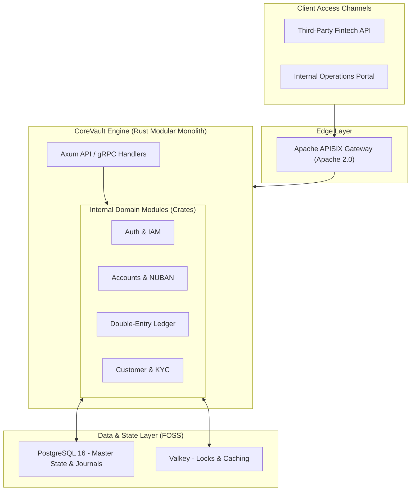

# Product Requirements Document (PRD)
# CoreVault — 100% Free & Open-Source Core Banking Platform in Rust

> **Version:** 2.1.0 (MVP / V1 Modular Monolith Edition)  
> **Date:** October 2026  
> **Status:** Approved MVP Architecture Draft  
> **Target Market:** Nigeria (CBN & NIBSS Compliant) with Multi-Country Platformization  

---

## 1. Executive Summary

**CoreVault** is an enterprise-grade core banking system engineered from the ground up in **Rust**. Built for high throughput, provable mathematical correctness, and zero ongoing vendor license taxes, every tool in CoreVault’s stack is **100% free and open-source software (FOSS)**.

To ensure rapid time-to-market and low operational overhead for the Version 1 MVP, CoreVault is deployed as a **Modular Monolith** backed by **PostgreSQL 16** and **Valkey**. It delivers full support for the Nigerian banking landscape (CBN regulations, NUBAN generation, double-entry bookkeeping) without the devastating DevOps burden of maintaining a dozen distributed microservices.

---

## 2. 100% Free & Open-Source (FOSS) Constraints & MVP Simplifications

For V1, we have intentionally avoided "distributed system sprawl." 

| Architectural Layer | V1 MVP Tool | Justification for MVP |
| :--- | :--- | :--- |
| **Primary Database (OLTP & Ledger)** | **PostgreSQL 16 HA** (PostgreSQL License) | Handles accounts, balances, and journals. Partitioning by date handles tens of thousands of TPS. Eliminates the need for a separate distributed database (YugabyteDB). |
| **Cache, Locks, & Rate Limiting** | **Valkey 7/8** (BSD 3-Clause) | 100% open-source alternative to Redis. Handles idempotency keys and API rate limiting perfectly. |
| **Search & KYC Indexing** | **PostgreSQL `pg_trgm` / `tsvector`** | Native Postgres full-text search is more than sufficient for V1 KYC lookups, eliminating the need to host OpenSearch. |
| **Secrets & Key Management** | **Application-Layer Rust AES-256** | Database credentials and master encryption keys are passed as Kubernetes/Environment Secrets on boot. Eliminates the overhead of OpenBao/Vault for V1. |
| **Asynchronous Tasks** | **Valkey Streams / Postgres LISTEN** | Replaces heavy event brokers (Kafka/RabbitMQ) for V1 task queuing (like sending SMS notifications). |

---

## 3. System Architecture Overview (Modular Monolith)



---

## 4. Technology Stack 

* **Language:** **Rust 1.81+**
* **Web & HTTP Framework:** **Axum 0.7** (REST APIs) & **Tonic 0.11** (gRPC inter-node communication for future scale).
* **Database Driver:** **SQLx 0.7** (Compile-time checked SQL queries).
* **Financial Math:** **`rust_decimal`** (128-bit fixed-point representation to avoid floating-point errors).

---

## 5. Domain Modules

### 5.1 Ledger & NUBAN Account Module
* Strict NUBAN 10-digit account verification enforced via the `[3, 7, 3, 3, 7, 3, 3, 7, 3]` mod-10 check digit algorithm in Rust.
* Support for Savings, Current, Domiciliary, and Internal GL accounts.

### 5.2 Double-Entry Bookkeeping Engine
* The core invariant: **For every transaction, Total Debits == Total Credits.**
* **Append-Only Balance Derivation:** To avoid row-level lock contention (`SELECT FOR UPDATE`), ledger entries are append-only. Balances are derived asynchronously or updated via optimistic concurrency control (version tracking).

---

## 6. Database Architecture (PostgreSQL)

```sql
CREATE EXTENSION IF NOT EXISTS "uuid-ossp";

-- Master Transactions
CREATE TABLE transactions (
    id UUID PRIMARY KEY DEFAULT gen_random_uuid(),
    transaction_ref VARCHAR(64) UNIQUE NOT NULL,
    idempotency_key VARCHAR(128) UNIQUE NOT NULL,
    status VARCHAR(20) NOT NULL DEFAULT 'PENDING',
    total_amount NUMERIC(20, 4) NOT NULL CHECK (total_amount > 0),
    currency_code CHAR(3) NOT NULL DEFAULT 'NGN',
    created_at TIMESTAMPTZ NOT NULL DEFAULT NOW()
) PARTITION BY RANGE (created_at);

-- Immutable Double-Entry Journal Legs
CREATE TABLE journal_entries (
    id UUID PRIMARY KEY DEFAULT gen_random_uuid(),
    transaction_id UUID NOT NULL REFERENCES transactions(id),
    account_id UUID NOT NULL REFERENCES accounts(id),
    entry_type CHAR(2) NOT NULL CHECK (entry_type IN ('DR', 'CR')),
    amount NUMERIC(20, 4) NOT NULL CHECK (amount > 0),
    created_at TIMESTAMPTZ NOT NULL DEFAULT NOW()
) PARTITION BY RANGE (created_at);
```

---

## 7. Security & Secrets Management (V1)

Instead of a heavy external secrets manager, V1 relies on:
1. **At-Rest Database Encryption:** Handled at the infrastructure layer (e.g., encrypted EBS volumes).
2. **Application-Layer Encryption:** PII (BVN, NIN) is encrypted by the Rust application using AES-256-GCM before writing to PostgreSQL.
3. **Environment Secrets:** The master AES key and database credentials are injected securely at runtime via Kubernetes Secrets or `.env` variables, never hardcoded.

---

## 8. Deployment Strategy

* **Sandbox / Dev:** A single `docker-compose.yml` spins up the Rust API, Postgres, and Valkey in < 10 seconds.
* **Production V1:** Deployed via Docker containers on a managed Kubernetes cluster or dedicated VMs within a Nigerian data center (e.g., MDXi / Layer3) to meet CBN data sovereignty requirements.