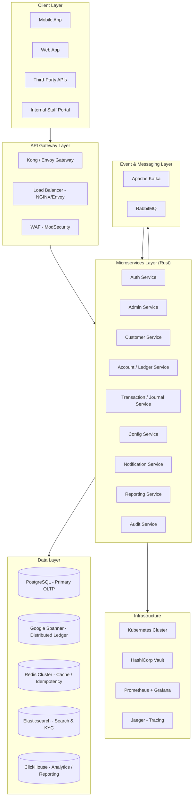
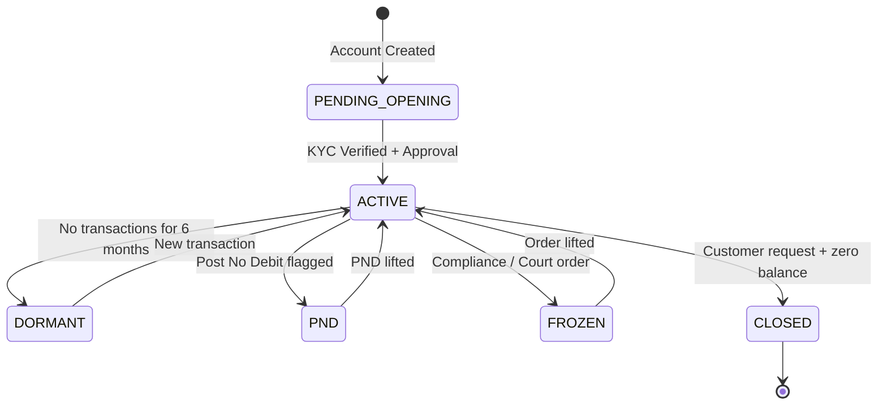
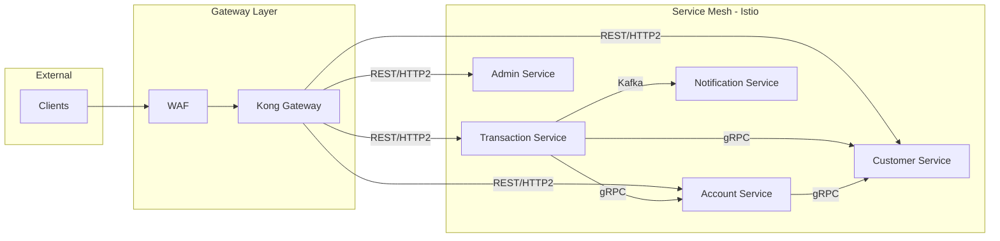
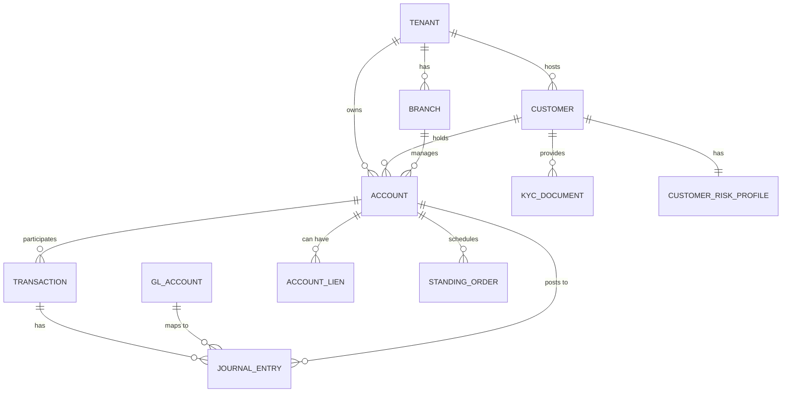

# Product Requirements Document (PRD)
# CoreVault — Core Banking Application in Rust

> **Version:** 1.0.0
> **Date:** October 2026
> **Status:** Draft
> **Authors:** Engineering Leadership

---

## Table of Contents

1. [Executive Summary](#1-executive-summary)
2. [Product Vision & Goals](#2-product-vision--goals)
3. [System Architecture Overview](#3-system-architecture-overview)
4. [Technology Stack & Justification](#4-technology-stack--justification)
5. [Domain Modules](#5-domain-modules)
   - 5.1 [Admin Module](#51-admin-module)
   - 5.2 [Configuration Module](#52-configuration-module)
   - 5.3 [Customer Profile Module](#53-customer-profile-module)
   - 5.4 [Ledger & Account Module (NUBAN)](#54-ledger--account-module-nuban)
   - 5.5 [Journal & Transactions Module](#55-journal--transactions-module)
   - 5.6 [Double-Entry Bookkeeping Engine](#56-double-entry-bookkeeping-engine)
6. [Database Architecture](#6-database-architecture)
7. [Messaging & Event Streaming](#7-messaging--event-streaming)
8. [API Gateway & Network Architecture](#8-api-gateway--network-architecture)
9. [Infrastructure: Kubernetes & Docker](#9-infrastructure-kubernetes--docker)
10. [Security Requirements](#10-security-requirements)
11. [Compliance & Regulatory Requirements](#11-compliance--regulatory-requirements)
12. [Observability & Monitoring](#12-observability--monitoring)
13. [Non-Functional Requirements](#13-non-functional-requirements)
14. [Data Models](#14-data-models)
15. [Deployment & Release Strategy](#15-deployment--release-strategy)
16. [Glossary](#16-glossary)

---

## 1. Executive Summary

**CoreVault** is a cloud-native, high-performance core banking platform built in Rust. It provides financial institutions — initially targeting the Nigerian banking ecosystem (CBN-compliant) — with a battle-hardened, double-entry ledger system, account management, NUBAN-compatible account numbering, customer lifecycle management, and real-time transaction journaling. The platform is designed to be **country-agnostic** via a multi-tenant configuration layer, allowing expansion to other jurisdictions (UK, US, Kenya, Ghana, etc.) without architectural changes.

CoreVault is built for **correctness above all else**: every naira (or currency unit) that enters the system must exit the system. No money is created or destroyed — it only moves.

---

## 2. Product Vision & Goals

### Vision
To be the foundational financial infrastructure layer that any licensed bank, fintech, microfinance institution, or neobank can deploy and operate with confidence — offering the correctness of traditional core banking with the developer experience and performance of modern cloud-native systems.

### Goals

| Goal | Metric |
|------|--------|
| Zero money loss guarantee | Double-entry enforced at DB + application layer |
| High throughput | ≥ 50,000 TPS (transactions per second) per shard |
| Low latency | p99 < 50ms for ledger writes |
| High availability | 99.999% uptime (five nines) |
| Regulatory compliance | CBN (Nigeria), ISO 20022, PCI-DSS Level 1 |
| Country platformization | Configuration-driven, not code-driven |
| Auditability | Full immutable audit trail for every state change |

---

## 3. System Architecture Overview



---

## 4. Technology Stack & Justification

### 4.1 Rust Framework — Axum

**Choice: `Axum` (by Tokio team)**

| Framework | Throughput | Ecosystem | Async | Justification |
|-----------|------------|-----------|-------|---------------|
| **Axum** ✅ | ~450k req/s | Excellent | Tokio-native | Best in class; tower middleware; tonic gRPC compatible |
| Actix-Web | ~500k req/s | Good | Custom | Actor model overhead; less composable middleware |
| Warp | ~400k req/s | Moderate | Tokio | Filter combinators complex at scale |

**Why Axum:**
- Built on `hyper` and `tower`, composable middleware stack via `tower::ServiceBuilder`
- Native integration with `tokio` runtime (battle-tested async runtime for IO-bound banking ops)
- Excellent gRPC support via `tonic` for inter-service communication
- `tower-http` for compression, tracing, CORS, auth middleware out-of-the-box
- `sqlx` for compile-time SQL query verification — critical for financial correctness

**Key Rust Crates:**

```toml
[dependencies]
# Web Framework
axum = { version = "0.7", features = ["macros"] }
tokio = { version = "1", features = ["full"] }
tower = { version = "0.4", features = ["full"] }
tower-http = { version = "0.5", features = ["trace", "cors", "auth", "compression-br"] }

# gRPC (inter-service)
tonic = "0.11"
prost = "0.12"

# Database
sqlx = { version = "0.7", features = ["postgres", "runtime-tokio-rustls", "uuid", "chrono", "rust_decimal"] }
redis = { version = "0.25", features = ["tokio-comp", "cluster"] }

# Serialization
serde = { version = "1", features = ["derive"] }
serde_json = "1"

# Decimal precision (CRITICAL for money)
rust_decimal = { version = "1.33", features = ["serde"] }
rust_decimal_macros = "1.33"

# UUID
uuid = { version = "1", features = ["v4", "serde"] }

# Time
chrono = { version = "0.4", features = ["serde"] }
time = "0.3"

# Error handling
thiserror = "1"
anyhow = "1"

# Tracing / Observability
tracing = "0.1"
tracing-subscriber = { version = "0.3", features = ["env-filter", "json"] }
opentelemetry = "0.22"
opentelemetry-otlp = "0.15"

# Kafka
rdkafka = { version = "0.36", features = ["tokio"] }

# Auth
jsonwebtoken = "9"
argon2 = "0.5"

# Config
config = "0.14"
dotenvy = "0.15"

# Validation
validator = { version = "0.18", features = ["derive"] }
```

---

### 4.2 Database Architecture & Justification

#### Primary OLTP Database — **PostgreSQL 16**

**Use case:** Customer profiles, account metadata, user management, configuration, audit logs, journal entries (append-only ledger).

**Why PostgreSQL over alternatives:**
- **ACID compliance** — Non-negotiable for financial data. PostgreSQL's MVCC implementation gives serializable isolation without explicit locking in most cases.
- **`SERIALIZABLE` isolation level** — Prevents phantom reads and write skew (double-spend attacks) via Serializable Snapshot Isolation (SSI).
- **`rust_decimal` + PostgreSQL `NUMERIC` type** — Exact decimal arithmetic; no floating point. Critical: `FLOAT` is **banned** from the money schema.
- **Row-level locking** with `SELECT FOR UPDATE NOWAIT` for hot ledger rows.
- **Logical replication** — Zero-downtime schema migrations with tools like `pglogical`.
- **Partitioning** — Time-based partitioning for journal/transaction tables (monthly partitions).
- **CitusDB extension** — Horizontal sharding of the PostgreSQL layer when single-node limits are hit.

**Deployment:** PostgreSQL with Patroni (HA) + pgBouncer (connection pooling) — 3-node cluster (1 primary + 2 synchronous replicas).

---

#### Distributed Ledger Database — **Google Spanner**

**Use case:** The core double-entry ledger balance table (account balances) that needs global consistency with horizontal scale.

**Why Google Spanner:**

| Feature | Spanner | CockroachDB | YugabyteDB |
|---------|---------|-------------|------------|
| Global consistency | True external consistency (TrueTime) | Serializable | Serializable |
| SQL dialect | Standard SQL + extensions | PostgreSQL wire | PostgreSQL wire |
| Multi-region writes | ✅ Native | ✅ Yes | ✅ Yes |
| Managed service | Fully managed | Self-managed or cloud | Self-managed or cloud |
| Financial use cases | Google Pay, Airtel Money | Cockroach Labs finance | General |
| Rust client | ✅ `google-cloud-spanner` crate | PostgreSQL driver | PostgreSQL driver |

**Justification for Spanner specifically:**
- **TrueTime API** guarantees causally consistent timestamps globally — no clock skew issues in distributed ledger writes.
- Used by **Google Pay** and **Airtel Money Africa** in production for billions of transactions.
- Eliminates the need for a Saga pattern on balance updates — Spanner's global transactions handle multi-account debits/credits atomically.
- Scales to millions of TPS without resharding.
- **Cost trade-off:** Spanner is expensive. For smaller deployments (< $50M AUM), **CockroachDB** is the recommended fallback with PostgreSQL wire compatibility.

> [!NOTE]
> **Platformization:** The `LedgerRepository` trait in Rust will abstract over the backing store. Switch between PostgreSQL (dev/small), CockroachDB (mid-scale), and Spanner (enterprise/global) by changing configuration — zero code change.

---

#### Cache Layer — **Redis Cluster (Valkey)**

**Use case:**
- Idempotency keys (prevent duplicate transaction submissions)
- Session tokens and JWT blacklisting
- Rate limiting (per-user, per-API-key sliding window)
- Hot account balance read cache (with write-through invalidation)
- Distributed locks (Redlock algorithm) for ledger operations
- OTP / PIN expiry cache

**Why Redis/Valkey:**
- **Lua scripting** — Atomic check-and-set for idempotency key validation
- **SETNX + TTL** for distributed locking
- Sub-millisecond latency for cache hits
- Redis Cluster (6 nodes: 3 primary + 3 replica) for HA

> [!WARNING]
> Redis is **NOT** the source of truth for balances. Cache invalidation follows a **write-through** pattern. On cache miss, always read from PostgreSQL/Spanner.

---

#### Search & KYC Database — **Elasticsearch 8**

**Use case:**
- Customer name search (fuzzy, phonetic)
- BVN / NIN lookup and deduplication
- Transaction search by narration, reference, counterparty
- AML/sanctions list screening (fuzzy name matching against OFAC, CBN watchlists)
- Audit log search

**Why Elasticsearch over alternatives:**
- Native full-text search with **BM25 ranking**
- **Phonetic analysis** (Soundex, Metaphone) for Nigerian name variants (e.g., "Chukwuemeka" vs "Emeka")
- Percolator queries for real-time AML rule matching
- Geo-queries for branch-level reporting
- Synced from PostgreSQL via **Debezium CDC** (Change Data Capture) → Kafka → Elasticsearch consumer

---

#### Analytics & Reporting Database — **ClickHouse**

**Use case:**
- Financial reporting (P&L, balance sheet, income statement)
- CBN regulatory reports (FSS, FINA, GAAP)
- Real-time dashboards (transaction volumes, fee income, NPL ratios)
- Fraud analytics (pattern detection over historical transactions)
- Customer segmentation

**Why ClickHouse over alternatives:**

| Feature | ClickHouse | BigQuery | Apache Druid |
|---------|------------|----------|--------------|
| Query speed (OLAP) | Sub-second on billions | ~2-10s | Sub-second |
| Self-hosted | ✅ | ❌ Managed only | ✅ |
| Real-time ingest | ✅ Via Kafka | Limited | ✅ |
| SQL dialect | SQL (mostly) | Standard SQL | SQL-like |
| Cost | Low (self-hosted) | Pay-per-query | High ops overhead |
| Columnar storage | ✅ MergeTree | ✅ | ✅ |

**Why ClickHouse beats BigQuery here:**
- Self-hosted = data sovereignty (CBN data residency requirements — data must remain in Nigeria)
- MergeTree engine with **ReplacingMergeTree** for upserts on ledger aggregates
- Kafka engine table — directly consume from Kafka without ETL pipeline code
- 10-100x faster than PostgreSQL for GROUP BY / window functions over millions of rows

> [!TIP]
> **Architecture pattern:** PostgreSQL is the write path (OLTP). ClickHouse is the read path (OLAP). Kafka bridges them via Debezium CDC. No direct queries on the OLTP DB for reports.

---

#### Summary: Database by Use Case

| Database | Use Case | Justification |
|----------|----------|---------------|
| **PostgreSQL 16** | Customer profiles, accounts metadata, configurations, audit logs | ACID, NUMERIC type, mature ecosystem |
| **Google Spanner** | Live ledger balances (double-entry) | Global consistency, horizontal scale, TrueTime |
| **Redis Cluster** | Cache, idempotency keys, distributed locks, rate limits | Sub-ms latency, atomic Lua scripting |
| **Elasticsearch 8** | Customer search, KYC dedup, AML screening, transaction search | Full-text, phonetic, percolator |
| **ClickHouse** | Analytics, regulatory reporting, fraud detection | Columnar OLAP, Kafka native, data residency |

---

## 5. Domain Modules

### 5.1 Admin Module

The Admin Module is the control plane for the entire platform. It is consumed by bank operations staff, compliance officers, IT administrators, and super-users.

#### 5.1.1 User Management

- **Role-Based Access Control (RBAC)** with fine-grained permissions
- Roles: `SUPER_ADMIN`, `BANK_ADMIN`, `OPERATIONS_OFFICER`, `TELLER`, `COMPLIANCE_OFFICER`, `AUDITOR`, `READONLY`
- **Multi-tenancy:** A single CoreVault deployment can host multiple banks/institutions (each as a `tenant`)
- **MFA enforcement:** TOTP (Google Authenticator / Authy) required for all admin users
- **IP allowlisting** per admin user / role
- Forced **password rotation** with bcrypt/Argon2id hashing
- Session management with short-lived JWTs (15-minute access token, 8-hour refresh token)

#### 5.1.2 Branch Management

```rust
pub struct Branch {
    pub id: Uuid,
    pub tenant_id: Uuid,
    pub code: String,         // e.g., "LAG001"
    pub name: String,
    pub sort_code: String,    // 6-digit CBN sort code
    pub address: Address,
    pub country_code: String, // ISO 3166-1 alpha-2
    pub is_active: bool,
    pub created_at: DateTime<Utc>,
}
```

#### 5.1.3 Staff Management

- Staff onboarding with approval workflow (4-eyes principle)
- Biometric / 2FA binding
- Staff transaction limits (daily, per-transaction)
- Activity log per staff member (all actions journaled)

#### 5.1.4 Holiday & Calendar Management

- Country/region-specific bank holiday calendars
- Business day calculation engine for value dating, maturity dates, and settlement
- Integration with CBN calendar for Nigeria; extendable per country

#### 5.1.5 Fee & Charge Configuration

- Fee schedules (flat, percentage, tiered, capped)
- Charge codes mapped to GL accounts
- VAT / tax configuration per product type
- Override approval workflow for fee waivers

#### 5.1.6 Admin API Endpoints

```
POST   /admin/tenants
GET    /admin/tenants/{tenant_id}
POST   /admin/users
PUT    /admin/users/{user_id}/roles
DELETE /admin/users/{user_id}
POST   /admin/branches
GET    /admin/branches
POST   /admin/fee-schedules
GET    /admin/audit-logs
GET    /admin/system-health
```

---

### 5.2 Configuration Module

The Configuration Module enables the platform to be adapted to any country's banking requirements without code changes — the **platformization layer**.

#### 5.2.1 Country Configuration

```toml
[country.NG]
name = "Nigeria"
currency_code = "NGN"
currency_symbol = "₦"
decimal_places = 2
account_number_format = "NUBAN"  # or "IBAN", "BBAN", "custom"
central_bank = "CBN"
sort_code_length = 6
account_number_length = 10
bvn_enabled = true
nin_enabled = true
regulatory_body = "CBN"
timezone = "Africa/Lagos"
business_days = ["Monday", "Tuesday", "Wednesday", "Thursday", "Friday"]

[country.GB]
name = "United Kingdom"
currency_code = "GBP"
account_number_format = "IBAN"
sort_code_length = 6
account_number_length = 8
regulatory_body = "FCA"
```

#### 5.2.2 Product Configuration

- **Savings products:** interest rates, compounding frequency, minimum balance, dormancy rules
- **Current accounts:** overdraft limits, transaction limits, cheque book eligibility
- **Fixed deposits:** tenor, auto-renewal rules, early liquidation penalties
- **Loan products:** interest computation method (flat, reducing balance, compound), repayment schedules

#### 5.2.3 GL (General Ledger) Chart of Accounts

- Pre-seeded CBN GAAP Chart of Accounts
- Configurable per country / institution
- Account class hierarchy: `Asset → Liability → Equity → Income → Expense`
- IFRS 9 provisioning categories

#### 5.2.4 Workflow Engine Configuration

- Configurable approval workflows (JSON-based state machine)
- Threshold-based approval: e.g., transactions > ₦5M require dual authorization
- SLA timers per workflow step

---

### 5.3 Customer Profile Module

#### 5.3.1 Customer Types

| Type | Description |
|------|-------------|
| `INDIVIDUAL` | Retail banking customer |
| `SME` | Small & medium enterprise |
| `CORPORATE` | Large corporate entity |
| `GOVERNMENT` | Government agency / MDAs |
| `NON_PROFIT` | NGOs, religious bodies |
| `FINANCIAL_INSTITUTION` | Correspondent banks, fintechs |

#### 5.3.2 KYC Tiers (CBN Tier System — Nigeria)

| Tier | Max Balance | Max Daily Txn | ID Required |
|------|-------------|----------------|-------------|
| Tier 1 | ₦300,000 | ₦50,000 | Phone number only |
| Tier 2 | ₦500,000 | ₦200,000 | NIN or BVN |
| Tier 3 | Unlimited | Unlimited | BVN + Govt ID + Utility Bill |

#### 5.3.3 Customer Data Model

```rust
pub struct Customer {
    pub id: Uuid,
    pub tenant_id: Uuid,
    pub customer_number: String,       // Auto-generated (e.g., "CUS20260001")
    pub customer_type: CustomerType,
    pub kyc_tier: KycTier,
    pub kyc_status: KycStatus,         // PENDING, VERIFIED, REJECTED, SUSPENDED
    pub title: Option<String>,
    pub first_name: String,
    pub middle_name: Option<String>,
    pub last_name: String,
    pub date_of_birth: NaiveDate,
    pub gender: Gender,
    pub nationality: String,           // ISO 3166-1 alpha-2
    pub bvn: Option<String>,           // Bank Verification Number (11 digits)
    pub nin: Option<String>,           // National Identification Number
    pub phone_numbers: Vec<PhoneNumber>,
    pub email_addresses: Vec<EmailAddress>,
    pub addresses: Vec<Address>,
    pub documents: Vec<KycDocument>,
    pub is_pep: bool,                  // Politically Exposed Person
    pub is_sanctioned: bool,
    pub risk_rating: RiskRating,       // LOW, MEDIUM, HIGH
    pub relationship_manager_id: Option<Uuid>,
    pub created_at: DateTime<Utc>,
    pub updated_at: DateTime<Utc>,
    pub is_active: bool,
}
```

#### 5.3.4 BVN Integration (Nigeria)

- Integration with **NIBSS** (Nigeria Inter-Bank Settlement System) BVN API
- BVN validation on account opening
- BVN-based customer deduplication (one customer per BVN across the platform)
- Async BVN verification with retry queue (Kafka-backed)

#### 5.3.5 KYC Document Management

- Document upload with type classification: `NATIONAL_ID`, `PASSPORT`, `DRIVERS_LICENSE`, `UTILITY_BILL`, `CAC_CERT`, `SIGNATURE`, `PHOTO`
- Document storage in **S3-compatible object store** (MinIO on-prem or AWS S3)
- Document expiry tracking and renewal reminders
- Automated OCR (via integration with Smile Identity or Youverify for Nigeria)

---

### 5.4 Ledger & Account Module (NUBAN)

#### 5.4.1 NUBAN Account Number Generation

The **Nigerian Uniform Bank Account Number (NUBAN)** is a 10-digit account number standard mandated by CBN. The algorithm is:

```
NUBAN = {Bank Code (3 digits)} + {Serial Number (6 digits)} + {Check Digit (1 digit)}
```

**Check Digit Algorithm:**

```rust
pub fn compute_nuban_check_digit(bank_code: &str, serial: &str) -> u8 {
    // Combine bank code and serial: 9 digits total
    let combined = format!("{}{}", bank_code, serial);
    let weights = [3u32, 7, 3, 3, 7, 3, 3, 7, 3];

    let sum: u32 = combined
        .chars()
        .zip(weights.iter())
        .map(|(c, w)| c.to_digit(10).unwrap() * w)
        .sum();

    let remainder = sum % 10;
    if remainder == 0 { 0 } else { (10 - remainder) as u8 }
}

pub fn generate_nuban(bank_code: &str, serial_number: u32) -> String {
    let serial = format!("{:06}", serial_number);
    let check = compute_nuban_check_digit(bank_code, &serial);
    format!("{}{}{}", bank_code, serial, check)
}
```

> [!IMPORTANT]
> For non-Nigerian deployments, the `AccountNumberGenerator` trait is implemented differently per country (IBAN for EU, BSB for Australia, Sort Code + Account Number for UK, etc.) without changing the account service interface.

#### 5.4.2 Account Types

| Type | Code | Description |
|------|------|-------------|
| `SAVINGS` | SAV | Interest-bearing savings account |
| `CURRENT` | CUR | Transactional / demand deposit |
| `FIXED_DEPOSIT` | FXD | Term deposit |
| `LOAN` | LON | Loan disbursement account |
| `DOMICILIARY` | DOM | Foreign currency account |
| `INTERNAL_GL` | IGL | Internal General Ledger account |
| `SUSPENSE` | SUS | Suspense / transit account |
| `NOSTRO` | NOS | Correspondent bank account |
| `VOSTRO` | VOS | Foreign bank account held with us |

#### 5.4.3 Account Data Model

```rust
pub struct Account {
    pub id: Uuid,
    pub tenant_id: Uuid,
    pub account_number: String,        // NUBAN (10 digits) for Nigeria
    pub account_name: String,
    pub account_type: AccountType,
    pub product_code: String,
    pub customer_id: Option<Uuid>,     // None for internal GL accounts
    pub currency_code: String,         // ISO 4217
    pub branch_id: Uuid,
    pub officer_id: Uuid,
    pub ledger_balance: Decimal,       // rust_decimal::Decimal (NEVER float)
    pub available_balance: Decimal,    // ledger_balance - holds + credits
    pub lien_amount: Decimal,          // Amount placed on lien
    pub overdraft_limit: Decimal,
    pub minimum_balance: Decimal,
    pub status: AccountStatus,         // ACTIVE, DORMANT, FROZEN, CLOSED, PND
    pub tier: KycTier,
    pub interest_rate: Option<Decimal>,
    pub last_transaction_date: Option<DateTime<Utc>>,
    pub maturity_date: Option<NaiveDate>, // For FDs
    pub opened_date: NaiveDate,
    pub closed_date: Option<NaiveDate>,
    pub created_at: DateTime<Utc>,
    pub updated_at: DateTime<Utc>,
}
```

#### 5.4.4 Account Status Lifecycle



#### 5.4.5 General Ledger Chart of Accounts

Accounts are organized into a hierarchical Chart of Accounts (CoA):

```
1000000 - ASSETS
  1100000 - Cash & Cash Equivalents
    1110000 - Cash in Vault
    1120000 - Cash at Central Bank
    1130000 - Cash in ATM
  1200000 - Loans & Advances
    1210000 - Retail Loans
    1220000 - Corporate Loans
  1300000 - Investments

2000000 - LIABILITIES
  2100000 - Customer Deposits
    2110000 - Savings Deposits
    2120000 - Current Deposits
    2130000 - Fixed Deposits
  2200000 - Borrowings

3000000 - EQUITY
  3100000 - Share Capital
  3200000 - Retained Earnings

4000000 - INCOME
  4100000 - Interest Income
  4200000 - Fee Income
  4300000 - Commission Income

5000000 - EXPENSES
  5100000 - Interest Expense
  5200000 - Operating Expenses
  5300000 - Loan Loss Provisions
```

---

### 5.5 Journal & Transactions Module

#### 5.5.1 Transaction Types

| Type | Code | Description |
|------|------|-------------|
| `DEPOSIT` | DEP | Cash/cheque deposit |
| `WITHDRAWAL` | WDL | Cash withdrawal |
| `TRANSFER_INTRA` | TRF_I | Intra-bank transfer |
| `TRANSFER_INTER` | TRF_E | Inter-bank transfer (NIBSS, NIP) |
| `NEFT` | NEFT | NEFT settlement |
| `RTGS` | RTGS | Real-time gross settlement |
| `DIRECT_DEBIT` | DDB | Direct debit mandate |
| `STANDING_ORDER` | SO | Scheduled recurring transfer |
| `LOAN_REPAYMENT` | LRP | Loan principal/interest payment |
| `LOAN_DISBURSEMENT` | LDS | Loan disbursement |
| `INTEREST_CREDIT` | INT | Interest accrual/credit |
| `CHARGE` | CHG | Bank fees and charges |
| `REVERSAL` | REV | Transaction reversal |
| `CARD_DEBIT` | CRD | POS/ATM card debit |
| `USSD` | USD | USSD channel transaction |

#### 5.5.2 Transaction Data Model

```rust
pub struct Transaction {
    pub id: Uuid,
    pub tenant_id: Uuid,
    pub transaction_reference: String,  // Unique, e.g., "TXN20261022ABCD1234"
    pub external_reference: Option<String>, // Customer/partner reference
    pub idempotency_key: String,        // Client-provided idempotency key
    pub transaction_type: TransactionType,
    pub channel: Channel,               // MOBILE, WEB, USSD, POS, ATM, TELLER, API
    pub status: TransactionStatus,      // PENDING, PROCESSING, COMPLETED, FAILED, REVERSED
    pub currency_code: String,
    pub amount: Decimal,
    pub narration: String,
    pub value_date: NaiveDate,
    pub posting_date: NaiveDate,
    pub journal_entries: Vec<JournalEntry>, // The actual double-entry legs
    pub metadata: serde_json::Value,
    pub initiated_by: Uuid,             // User/system that initiated
    pub approved_by: Option<Uuid>,
    pub created_at: DateTime<Utc>,
    pub completed_at: Option<DateTime<Utc>>,
}
```

#### 5.5.3 Idempotency

Every transaction submission **must** include an `idempotency_key`. The system:

1. Checks Redis for existing key → returns cached response if found
2. If not found, proceeds with transaction
3. On completion, stores result in Redis with 24-hour TTL
4. Concurrent duplicate requests are held with a Redis lock until the first completes

---

### 5.6 Double-Entry Bookkeeping Engine

This is the **financial correctness core** of CoreVault. Every financial movement is recorded as a pair (or set) of journal entries where:

> **Total Debits = Total Credits** (always, enforced at application + database level)

#### 5.6.1 Journal Entry Model

```rust
pub struct JournalEntry {
    pub id: Uuid,
    pub transaction_id: Uuid,
    pub entry_sequence: i32,           // Order within transaction
    pub account_id: Uuid,
    pub account_number: String,
    pub entry_type: EntryType,         // DEBIT or CREDIT
    pub amount: Decimal,               // Always positive
    pub currency_code: String,
    pub running_balance: Decimal,      // Balance after this entry
    pub narration: String,
    pub gl_code: String,               // General Ledger code
    pub value_date: NaiveDate,
    pub created_at: DateTime<Utc>,
}

pub enum EntryType {
    Debit,   // Decreases liability/equity/income, increases assets/expenses
    Credit,  // Increases liability/equity/income, decreases assets/expenses
}
```

#### 5.6.2 Double-Entry Validation Rules

```rust
pub fn validate_journal_entries(entries: &[JournalEntry]) -> Result<(), LedgerError> {
    // Rule 1: Must have at least 2 entries
    if entries.len() < 2 {
        return Err(LedgerError::InsufficientEntries);
    }

    // Rule 2: Debits must equal credits (with currency grouping)
    let mut totals: HashMap<&str, (Decimal, Decimal)> = HashMap::new(); // (debit, credit)
    for entry in entries {
        let (debit, credit) = totals.entry(&entry.currency_code).or_default();
        match entry.entry_type {
            EntryType::Debit => *debit += entry.amount,
            EntryType::Credit => *credit += entry.amount,
        }
    }

    for (currency, (debit, credit)) in &totals {
        if debit != credit {
            return Err(LedgerError::ImbalancedEntries {
                currency: currency.to_string(),
                debit: *debit,
                credit: *credit,
            });
        }
    }

    // Rule 3: No zero-amount entries
    if entries.iter().any(|e| e.amount.is_zero()) {
        return Err(LedgerError::ZeroAmountEntry);
    }

    // Rule 4: No negative amounts
    if entries.iter().any(|e| e.amount.is_sign_negative()) {
        return Err(LedgerError::NegativeAmountEntry);
    }

    Ok(())
}
```

#### 5.6.3 Example: Intra-bank Transfer (₦50,000 from Account A to Account B)

| # | Account | Dr/Cr | Amount | GL Code |
|---|---------|-------|--------|---------|
| 1 | Customer A (Savings) | **Dr** | ₦50,000 | 2110001 |
| 2 | Customer B (Savings) | **Cr** | ₦50,000 | 2110002 |
| **Total** | | | **₦100,000** | Dr=Cr ✅ |

#### 5.6.4 Example: Cash Deposit with Bank Charges

| # | Account | Dr/Cr | Amount | GL Code |
|---|---------|-------|--------|---------|
| 1 | Cash in Vault | **Dr** | ₦100,000 | 1110000 |
| 2 | Customer A (Savings) | **Cr** | ₦99,900 | 2110001 |
| 3 | Fee Income | **Cr** | ₦100 | 4200000 |
| **Total** | | | **₦200,000** | Dr=Cr ✅ |

#### 5.6.5 Database Enforcement

```sql
-- PostgreSQL constraint ensuring balance integrity
CREATE OR REPLACE FUNCTION check_journal_balance()
RETURNS TRIGGER AS $$
DECLARE
    debit_sum  NUMERIC;
    credit_sum NUMERIC;
BEGIN
    SELECT
        SUM(CASE WHEN entry_type = 'DEBIT' THEN amount ELSE 0 END),
        SUM(CASE WHEN entry_type = 'CREDIT' THEN amount ELSE 0 END)
    INTO debit_sum, credit_sum
    FROM journal_entries
    WHERE transaction_id = NEW.transaction_id;

    IF debit_sum != credit_sum THEN
        RAISE EXCEPTION 'Imbalanced journal: debits=%, credits=%',
            debit_sum, credit_sum;
    END IF;

    RETURN NEW;
END;
$$ LANGUAGE plpgsql;

CREATE CONSTRAINT TRIGGER enforce_double_entry
AFTER INSERT ON journal_entries
DEFERRABLE INITIALLY DEFERRED  -- Check at end of transaction, not per-row
FOR EACH ROW EXECUTE FUNCTION check_journal_balance();
```

#### 5.6.6 Balance Update Strategy (Spanner / PostgreSQL)

```
BEGIN SERIALIZABLE;

-- Lock accounts in consistent order (prevent deadlocks)
SELECT ledger_balance FROM accounts
WHERE account_id IN ($debit_account, $credit_account)
ORDER BY account_id  -- Always same order!
FOR UPDATE NOWAIT;

-- Check sufficient funds
IF debit_account.ledger_balance - $amount < -debit_account.overdraft_limit THEN
    RAISE insufficient_funds;

-- Insert journal entries
INSERT INTO journal_entries (...) VALUES (...), (...);

-- Update balances
UPDATE accounts SET ledger_balance = ledger_balance - $amount
    WHERE account_id = $debit_account;
UPDATE accounts SET ledger_balance = ledger_balance + $amount
    WHERE account_id = $credit_account;

COMMIT;
```

---

## 6. Database Architecture

### 6.1 Schema Design Principles

1. **Never use `FLOAT` or `DOUBLE` for money** — Use `NUMERIC(20, 4)` in PostgreSQL, `DECIMAL` in Spanner
2. **All money in Rust** uses `rust_decimal::Decimal` (128-bit, exact decimal)
3. **Soft deletes only** — No hard `DELETE` on financial records (regulatory requirement)
4. **Immutable journal entries** — Once written, journal entries are never updated; reversals create new entries
5. **Tenant isolation** — Every table includes `tenant_id` with Row-Level Security (RLS) in PostgreSQL
6. **UUIDs** for all primary keys (v4 random, to avoid sequential ID leakage)
7. **Optimistic locking** via `updated_at` version fields for non-financial entities

### 6.2 PostgreSQL Schema (Core Tables)

```sql
-- Tenants
CREATE TABLE tenants (
    id UUID PRIMARY KEY DEFAULT gen_random_uuid(),
    code VARCHAR(10) UNIQUE NOT NULL,
    name VARCHAR(255) NOT NULL,
    country_code CHAR(2) NOT NULL,
    is_active BOOLEAN NOT NULL DEFAULT true,
    created_at TIMESTAMPTZ NOT NULL DEFAULT NOW()
);

-- Customers
CREATE TABLE customers (
    id UUID PRIMARY KEY DEFAULT gen_random_uuid(),
    tenant_id UUID NOT NULL REFERENCES tenants(id),
    customer_number VARCHAR(20) UNIQUE NOT NULL,
    customer_type VARCHAR(30) NOT NULL,
    kyc_tier SMALLINT NOT NULL DEFAULT 1,
    kyc_status VARCHAR(20) NOT NULL DEFAULT 'PENDING',
    first_name VARCHAR(100) NOT NULL,
    last_name VARCHAR(100) NOT NULL,
    date_of_birth DATE,
    bvn CHAR(11),
    nin VARCHAR(20),
    is_pep BOOLEAN NOT NULL DEFAULT false,
    risk_rating VARCHAR(10) NOT NULL DEFAULT 'LOW',
    is_active BOOLEAN NOT NULL DEFAULT true,
    created_at TIMESTAMPTZ NOT NULL DEFAULT NOW(),
    updated_at TIMESTAMPTZ NOT NULL DEFAULT NOW()
);

CREATE UNIQUE INDEX idx_customers_bvn ON customers(tenant_id, bvn) WHERE bvn IS NOT NULL;

-- Accounts
CREATE TABLE accounts (
    id UUID PRIMARY KEY DEFAULT gen_random_uuid(),
    tenant_id UUID NOT NULL REFERENCES tenants(id),
    account_number VARCHAR(20) UNIQUE NOT NULL,
    account_name VARCHAR(255) NOT NULL,
    account_type VARCHAR(20) NOT NULL,
    customer_id UUID REFERENCES customers(id),
    currency_code CHAR(3) NOT NULL DEFAULT 'NGN',
    branch_id UUID NOT NULL,
    ledger_balance NUMERIC(20, 4) NOT NULL DEFAULT 0,
    available_balance NUMERIC(20, 4) NOT NULL DEFAULT 0,
    lien_amount NUMERIC(20, 4) NOT NULL DEFAULT 0,
    overdraft_limit NUMERIC(20, 4) NOT NULL DEFAULT 0,
    minimum_balance NUMERIC(20, 4) NOT NULL DEFAULT 0,
    status VARCHAR(20) NOT NULL DEFAULT 'PENDING_OPENING',
    created_at TIMESTAMPTZ NOT NULL DEFAULT NOW(),
    updated_at TIMESTAMPTZ NOT NULL DEFAULT NOW(),
    CONSTRAINT positive_lien CHECK (lien_amount >= 0),
    CONSTRAINT positive_overdraft CHECK (overdraft_limit >= 0)
);

-- Transactions
CREATE TABLE transactions (
    id UUID PRIMARY KEY DEFAULT gen_random_uuid(),
    tenant_id UUID NOT NULL REFERENCES tenants(id),
    transaction_reference VARCHAR(50) UNIQUE NOT NULL,
    idempotency_key VARCHAR(100) NOT NULL,
    transaction_type VARCHAR(30) NOT NULL,
    channel VARCHAR(20) NOT NULL,
    status VARCHAR(20) NOT NULL DEFAULT 'PENDING',
    currency_code CHAR(3) NOT NULL,
    amount NUMERIC(20, 4) NOT NULL CHECK (amount > 0),
    narration TEXT,
    value_date DATE NOT NULL,
    posting_date DATE NOT NULL DEFAULT CURRENT_DATE,
    initiated_by UUID NOT NULL,
    created_at TIMESTAMPTZ NOT NULL DEFAULT NOW(),
    completed_at TIMESTAMPTZ
) PARTITION BY RANGE (posting_date);  -- Monthly partitions

CREATE UNIQUE INDEX idx_transactions_idempotency
    ON transactions(tenant_id, idempotency_key);

-- Journal Entries (IMMUTABLE)
CREATE TABLE journal_entries (
    id UUID PRIMARY KEY DEFAULT gen_random_uuid(),
    tenant_id UUID NOT NULL REFERENCES tenants(id),
    transaction_id UUID NOT NULL REFERENCES transactions(id),
    entry_sequence SMALLINT NOT NULL,
    account_id UUID NOT NULL REFERENCES accounts(id),
    account_number VARCHAR(20) NOT NULL,
    entry_type CHAR(6) NOT NULL CHECK (entry_type IN ('DEBIT', 'CREDIT')),
    amount NUMERIC(20, 4) NOT NULL CHECK (amount > 0),
    currency_code CHAR(3) NOT NULL,
    running_balance NUMERIC(20, 4) NOT NULL,
    gl_code VARCHAR(20) NOT NULL,
    narration TEXT,
    value_date DATE NOT NULL,
    created_at TIMESTAMPTZ NOT NULL DEFAULT NOW()
    -- NO updated_at: journal entries are immutable
) PARTITION BY RANGE (created_at);
```

### 6.3 Connection Pooling

- **PgBouncer** in transaction mode: max 100 connections per PostgreSQL instance
- **sqlx** `PgPool` with `max_connections = 20` per service instance
- Connection pool sizing: `(CPU cores × 2) + effective_io_concurrency`

---

## 7. Messaging & Event Streaming

### 7.1 Apache Kafka

**Use Case:** Core event streaming bus for all financial events.

**Kafka Topics:**

| Topic | Retention | Partitions | Description |
|-------|-----------|------------|-------------|
| `banking.transactions.created` | 30 days | 32 | New transaction events |
| `banking.transactions.completed` | 30 days | 32 | Completed transaction events |
| `banking.transactions.failed` | 90 days | 16 | Failed transaction events |
| `banking.journal.entries` | 7 years | 64 | Immutable journal events (regulatory) |
| `banking.accounts.events` | 30 days | 16 | Account state changes |
| `banking.customers.events` | 30 days | 16 | Customer profile changes |
| `banking.kyc.verification` | 30 days | 8 | KYC verification requests/results |
| `banking.notifications` | 7 days | 16 | Email/SMS/push notification events |
| `banking.audit.events` | 7 years | 32 | All system audit events |
| `banking.deadletter` | 90 days | 8 | Failed event processing |

**Kafka Configuration:**
```yaml
# Kafka broker config
num.partitions: 32
replication.factor: 3
min.insync.replicas: 2
default.retention.ms: 2592000000  # 30 days
log.cleanup.policy: delete
compression.type: lz4
acks: all  # Producer must get ack from all ISR
```

**Rust Kafka Producer (rdkafka):**
```rust
pub struct KafkaEventPublisher {
    producer: FutureProducer,
}

impl KafkaEventPublisher {
    pub async fn publish<T: Serialize>(
        &self,
        topic: &str,
        key: &str,
        event: &T,
    ) -> Result<(), PublishError> {
        let payload = serde_json::to_vec(event)?;
        let record = FutureRecord::to(topic)
            .key(key)
            .payload(&payload)
            .headers(OwnedHeaders::new()
                .insert(Header { key: "event_version", value: Some("1") })
                .insert(Header { key: "tenant_id", value: Some(&self.tenant_id) })
            );

        self.producer
            .send(record, Duration::from_secs(5))
            .await
            .map_err(|(e, _)| PublishError::Kafka(e))?;

        Ok(())
    }
}
```

### 7.2 RabbitMQ

**Use Case:** Command queues, retry logic, and bounded-context async tasks.

| Exchange | Type | Queues | Use Case |
|----------|------|--------|----------|
| `banking.commands` | Direct | kyc-verify, aml-screen | Command dispatch |
| `banking.notifications` | Topic | email, sms, push | Multi-channel notifications |
| `banking.retry` | x-delayed | *.retry | Exponential backoff retries |
| `banking.dlx` | Fanout | dead-letters | Dead letter processing |

**Why both Kafka and RabbitMQ:**
- **Kafka:** Event sourcing, audit trail, analytics pipeline, high-throughput streaming (append-only log)
- **RabbitMQ:** Point-to-point commands, work queues with complex routing, guaranteed delivery with acks and DLX

### 7.3 Event Schema (CloudEvents)

All events follow the [CloudEvents](https://cloudevents.io/) specification:

```json
{
  "specversion": "1.0",
  "type": "banking.transaction.completed",
  "source": "//corevault/transaction-service",
  "id": "a1b2c3d4-...",
  "time": "2026-10-22T10:30:00Z",
  "tenantid": "tenant-uuid",
  "datacontenttype": "application/json",
  "data": {
    "transaction_id": "...",
    "amount": "50000.00",
    "currency": "NGN",
    "status": "COMPLETED"
  }
}
```

### 7.4 Outbox Pattern

To guarantee **exactly-once** event delivery from the database to Kafka:

```
1. Transaction Service writes to DB (transaction + journal) AND outbox table in same DB transaction
2. Debezium CDC reads outbox table changes via PostgreSQL WAL
3. Debezium publishes to Kafka
4. On Kafka ack, outbox record is marked processed
```

This prevents the dual-write problem (DB write succeeds but Kafka publish fails = lost event).

---

## 8. API Gateway & Network Architecture

### 8.1 API Gateway — Kong Gateway

**Why Kong:**
- **Plugin ecosystem:** JWT auth, rate limiting, request transformation, CORS, logging
- **Declarative config** (deck) — GitOps-friendly
- **Admin API** for dynamic route registration
- Runs on top of Envoy proxy for high performance

**Alternative:** AWS API Gateway (if cloud-hosted) or Envoy (more control, less features out of box).

### 8.2 Service Communication



**Internal communication:** gRPC (via `tonic`) for synchronous service-to-service calls
**External communication:** REST/HTTP over TLS 1.3

### 8.3 Network Architecture

```
Internet
  │
  ▼
[CloudFlare / DDoS Protection]
  │
  ▼
[Load Balancer (NGINX / AWS ALB)]
  │
  ▼
[WAF (ModSecurity / AWS WAF)]
  │
  ├──► [API Gateway (Kong)] ─── DMZ
  │
[Kubernetes Cluster - Private VPC]
  ├── Service Mesh (Istio / Linkerd)
  ├── Microservices Pods
  ├── Database tier (private subnet, no public IP)
  └── Message brokers (private subnet)
```

**Network Zones:**

| Zone | Access | Contents |
|------|--------|----------|
| **DMZ** | Public internet → | Load balancer, WAF, API Gateway |
| **Application** | DMZ → | Kubernetes pods (services) |
| **Data** | Application → | PostgreSQL, Redis, Kafka |
| **Management** | VPN only | Monitoring, admin tools, CI/CD |

### 8.4 TLS Configuration

- **TLS 1.3 minimum** (TLS 1.2 allowed for legacy CBN integrations with 2-year sunset)
- mTLS within the service mesh (Istio handles certificate rotation automatically)
- Certificate management: **cert-manager** with Let's Encrypt (external) + internal CA (Vault PKI)

---

## 9. Infrastructure: Kubernetes & Docker

### 9.1 Kubernetes Cluster Architecture

```yaml
# Cluster topology (Production)
Nodes:
  Control Plane: 3 nodes (m5.xlarge) - HA etcd
  Worker - Application: 6+ nodes (m5.2xlarge, auto-scaling)
  Worker - Database: 3 nodes (r5.4xlarge, memory-optimized) - StatefulSets
  Worker - Kafka: 3 nodes (i3.2xlarge, storage-optimized)
```

### 9.2 Kubernetes Manifests (Key Resources)

**Transaction Service Deployment:**
```yaml
apiVersion: apps/v1
kind: Deployment
metadata:
  name: transaction-service
  namespace: banking-core
spec:
  replicas: 3
  strategy:
    type: RollingUpdate
    rollingUpdate:
      maxUnavailable: 0       # Zero-downtime deployments
      maxSurge: 1
  selector:
    matchLabels:
      app: transaction-service
  template:
    metadata:
      annotations:
        prometheus.io/scrape: "true"
        prometheus.io/port: "9090"
    spec:
      containers:
      - name: transaction-service
        image: corevault/transaction-service:1.0.0
        ports:
        - containerPort: 8080  # HTTP
        - containerPort: 50051 # gRPC
        - containerPort: 9090  # Metrics
        resources:
          requests:
            cpu: "500m"
            memory: "512Mi"
          limits:
            cpu: "2000m"
            memory: "2Gi"
        env:
        - name: DATABASE_URL
          valueFrom:
            secretKeyRef:
              name: db-secrets
              key: transaction_db_url
        livenessProbe:
          httpGet:
            path: /health/live
            port: 8080
          initialDelaySeconds: 10
          periodSeconds: 10
        readinessProbe:
          httpGet:
            path: /health/ready
            port: 8080
          initialDelaySeconds: 5
          periodSeconds: 5
        securityContext:
          runAsNonRoot: true
          runAsUser: 1000
          readOnlyRootFilesystem: true
          allowPrivilegeEscalation: false
      affinity:
        podAntiAffinity:
          requiredDuringSchedulingIgnoredDuringExecution:
          - labelSelector:
              matchLabels:
                app: transaction-service
            topologyKey: kubernetes.io/hostname  # One pod per node
```

**HorizontalPodAutoscaler:**
```yaml
apiVersion: autoscaling/v2
kind: HorizontalPodAutoscaler
metadata:
  name: transaction-service-hpa
spec:
  scaleTargetRef:
    apiVersion: apps/v1
    kind: Deployment
    name: transaction-service
  minReplicas: 3
  maxReplicas: 50
  metrics:
  - type: Resource
    resource:
      name: cpu
      target:
        type: Utilization
        averageUtilization: 70
  - type: Pods
    pods:
      metric:
        name: http_requests_per_second
      target:
        type: AverageValue
        averageValue: "1000"
```

### 9.3 Docker Configuration

**Multi-stage Dockerfile (Rust — optimized for size):**

```dockerfile
# ---- Builder Stage ----
FROM rust:1.81-slim-bookworm AS builder

WORKDIR /app

# Install build dependencies
RUN apt-get update && apt-get install -y \
    pkg-config libssl-dev libpq-dev \
    && rm -rf /var/lib/apt/lists/*

# Cache dependencies (layer optimization)
COPY Cargo.toml Cargo.lock ./
RUN mkdir src && echo "fn main() {}" > src/main.rs
RUN cargo build --release
RUN rm -f target/release/deps/transaction_service*

# Build application
COPY src ./src
RUN cargo build --release

# ---- Runtime Stage ----
FROM debian:bookworm-slim AS runtime

RUN apt-get update && apt-get install -y \
    libssl3 libpq5 ca-certificates \
    && rm -rf /var/lib/apt/lists/*

# Create non-root user
RUN groupadd -r banking && useradd -r -g banking -u 1000 banking

WORKDIR /app
COPY --from=builder /app/target/release/transaction-service ./
COPY migrations ./migrations

USER banking

EXPOSE 8080 50051 9090

HEALTHCHECK --interval=30s --timeout=10s --start-period=5s --retries=3 \
    CMD curl -f http://localhost:8080/health/live || exit 1

ENTRYPOINT ["./transaction-service"]
```

> [!TIP]
> Using `cargo-chef` (https://github.com/LukeMathWalker/cargo-chef) significantly speeds up Docker builds by caching Rust dependency compilation layers separately from application code — critical for CI/CD pipelines.

### 9.4 Helm Charts

Each service is packaged as a Helm chart with:
- `values.yaml` — environment-agnostic defaults
- `values.prod.yaml` — production overrides
- `values.staging.yaml` — staging overrides
- `Chart.yaml` — chart metadata
- `templates/` — deployment, service, HPA, PDB, ingress manifests

**ArgoCD** is used for GitOps-based deployment — changes to the `main` branch of the infra repo trigger automatic deployment to staging; production requires a manual approval gate.

---

## 10. Security Requirements

### 10.1 Authentication & Authorization

| Layer | Mechanism |
|-------|-----------|
| External API | OAuth 2.0 / JWT (RS256) |
| Admin Portal | SAML 2.0 / OIDC + MFA |
| Service-to-service | mTLS (Istio) + JWT |
| Database | PostgreSQL roles + Row-Level Security |
| Secrets | HashiCorp Vault (dynamic secrets) |

### 10.2 Data Protection

- **Data at rest:** AES-256 encryption for all database volumes and object storage
- **Data in transit:** TLS 1.3 everywhere
- **PII encryption:** Customer PII (BVN, NIN, DOB) encrypted at the application layer using **AES-256-GCM** with keys from HashiCorp Vault, not just at the DB layer
- **Tokenization:** Card PANs (if applicable) tokenized via PCI-DSS-compliant tokenization vault

### 10.3 Fraud Prevention

- Real-time transaction scoring engine (rule-based + ML model)
- Velocity checks: max N transactions in X minutes per account
- Geolocation anomaly detection
- Device fingerprinting for mobile/web channels
- NIBSS watchlist screening on every transaction

### 10.4 Security Controls

- **OWASP Top 10** mitigations enforced via WAF
- **SQL Injection:** Prevented by compile-time `sqlx` queries (no string interpolation)
- **Rate limiting:** Per-user, per-IP, per-API-key at Kong layer
- **Input validation:** `validator` crate with `#[derive(Validate)]` on all request DTOs
- **Secret rotation:** HashiCorp Vault dynamic credentials rotated every 24 hours
- **Vulnerability scanning:** Trivy in CI pipeline (block on HIGH/CRITICAL CVEs)
- **Penetration testing:** Quarterly by CBN-approved vendors

---

## 11. Compliance & Regulatory Requirements

### 11.1 Nigeria (CBN) Requirements

| Requirement | Implementation |
|-------------|----------------|
| NUBAN compliance | 10-digit account number with CBN check algorithm |
| BVN verification | NIBSS BVN API integration |
| NIP/NEFT settlement | NIBSS Instant Payment integration |
| RTGS | CBN RTGS system integration |
| CBN returns | Automated regulatory report generation (ClickHouse) |
| AML/CFT | Real-time screening + SAR filing workflow |
| Data residency | All data stored in Nigerian data centers or compliant cloud regions |
| KYC tiers | 3-tier KYC as mandated by CBN |
| Transaction limits | Enforced per KYC tier per CBN directives |

### 11.2 Country Platformization

The platform is designed to swap compliance modules via configuration:

```rust
pub trait ComplianceEngine: Send + Sync {
    async fn validate_account_number(&self, number: &str) -> Result<(), ComplianceError>;
    async fn verify_identity(&self, customer: &Customer) -> Result<VerificationResult, ComplianceError>;
    async fn screen_transaction(&self, txn: &Transaction) -> Result<ScreeningResult, ComplianceError>;
    async fn get_transaction_limits(&self, tier: &KycTier) -> TransactionLimits;
}

// Nigeria implementation
pub struct NigeriaComplianceEngine {
    nibss_client: NibssClient,
    cbn_config: CbnConfig,
}

// UK implementation
pub struct UkComplianceEngine {
    fca_client: FcaClient,
    faster_payments: FasterPaymentsClient,
}
```

### 11.3 International Standards

- **ISO 20022** — Message standard for all SWIFT/correspondent banking messages
- **PCI-DSS Level 1** — If card-present or card-number storage is in scope
- **GDPR** — For any EU customer data (right to erasure via pseudonymization)
- **SOC 2 Type II** — Annual audit for enterprise customers

---

## 12. Observability & Monitoring

### 12.1 Metrics — Prometheus + Grafana

**Key Metrics:**

```rust
// Custom metrics exposed via /metrics endpoint
lazy_static! {
    static ref TRANSACTION_COUNTER: CounterVec = register_counter_vec!(
        "banking_transactions_total",
        "Total number of transactions processed",
        &["tenant", "type", "status", "channel"]
    ).unwrap();

    static ref TRANSACTION_DURATION: HistogramVec = register_histogram_vec!(
        "banking_transaction_duration_seconds",
        "Transaction processing duration",
        &["tenant", "type"],
        vec![0.001, 0.005, 0.01, 0.025, 0.05, 0.1, 0.25, 0.5, 1.0, 2.5]
    ).unwrap();

    static ref LEDGER_BALANCE_GAUGE: GaugeVec = register_gauge_vec!(
        "banking_ledger_balance_total",
        "Total ledger balance by currency",
        &["tenant", "currency", "account_type"]
    ).unwrap();
}
```

**Grafana Dashboards:**
- Transaction throughput (TPS) by service and channel
- Latency percentiles (p50, p95, p99) per endpoint
- Error rates and failure heatmaps
- Database connection pool utilization
- Kafka consumer lag per topic
- Balance reconciliation dashboard

### 12.2 Distributed Tracing — Jaeger / OpenTelemetry

Every request carries a `trace_id` propagated via W3C Trace Context headers across all services. Spans are sent to Jaeger via the **OpenTelemetry OTLP** protocol.

```rust
// Axum tracing middleware setup
let app = Router::new()
    .route("/transactions", post(create_transaction))
    .layer(
        TraceLayer::new_for_http()
            .make_span_with(|request: &Request<Body>| {
                tracing::info_span!(
                    "http_request",
                    method = %request.method(),
                    uri = %request.uri(),
                    trace_id = %get_trace_id(),
                    tenant_id = %extract_tenant_id(request),
                )
            })
    );
```

### 12.3 Logging — Structured JSON

All logs use structured JSON format (no plain text logs in production):

```json
{
  "timestamp": "2026-10-22T10:30:00.000Z",
  "level": "INFO",
  "service": "transaction-service",
  "trace_id": "4bf92f3577b34da6",
  "span_id": "00f067aa0ba902b7",
  "tenant_id": "abc123",
  "message": "Transaction completed",
  "transaction_id": "txn-uuid",
  "amount": "50000.00",
  "duration_ms": 23
}
```

Log aggregation: **Fluent Bit** (DaemonSet on each k8s node) → **OpenSearch** (self-hosted) / **Elasticsearch**

### 12.4 Alerting

| Alert | Condition | Severity |
|-------|-----------|----------|
| High error rate | Error rate > 1% for 5 minutes | Critical |
| Ledger imbalance | Any debit ≠ credit detection | P0 (Page immediately) |
| Database lag | Replication lag > 30 seconds | Critical |
| Kafka consumer lag | Lag > 10,000 messages | Warning |
| p99 latency | > 200ms for 5 minutes | Warning |
| Certificate expiry | < 14 days remaining | Warning |
| Failed login spike | > 100 failed logins in 1 minute | Critical |

---

## 13. Non-Functional Requirements

| Requirement | Target |
|-------------|--------|
| **Throughput** | 50,000 TPS sustained per shard |
| **Latency** | p50 < 10ms, p95 < 30ms, p99 < 50ms (ledger writes) |
| **Availability** | 99.999% (≤ 5.26 min/year downtime) |
| **RTO** (Recovery Time Objective) | < 4 minutes |
| **RPO** (Recovery Point Objective) | < 1 second (synchronous replication) |
| **Data Retention** | Transaction records: 7 years (CBN requirement) |
| **Audit Trail** | 100% of state changes logged |
| **Idempotency** | All transaction endpoints idempotent |
| **Consistency** | Serializable isolation for all financial writes |
| **Scalability** | Horizontal scale to 10x load without architecture change |
| **Security Scan** | Zero HIGH/CRITICAL CVEs in production images |

---

## 14. Data Models

### 14.1 Entity-Relationship Diagram



### 14.2 Audit Log Model

```rust
pub struct AuditLog {
    pub id: Uuid,
    pub tenant_id: Uuid,
    pub entity_type: String,    // "Account", "Customer", "Transaction"
    pub entity_id: Uuid,
    pub action: String,         // "CREATE", "UPDATE", "DELETE", "APPROVE"
    pub actor_id: Uuid,
    pub actor_type: ActorType,  // USER, SYSTEM, API_KEY
    pub old_value: Option<serde_json::Value>,
    pub new_value: Option<serde_json::Value>,
    pub ip_address: Option<IpAddr>,
    pub user_agent: Option<String>,
    pub trace_id: String,
    pub created_at: DateTime<Utc>,
}
```

---

## 15. Deployment & Release Strategy

### 15.1 Environments

| Environment | Purpose | Auto-deploy |
|-------------|---------|-------------|
| `development` | Local dev (docker-compose) | N/A |
| `staging` | Integration testing, UAT | On merge to `main` |
| `performance` | Load testing, chaos engineering | Manual |
| `production` | Live banking operations | Manual approval |

### 15.2 CI/CD Pipeline (GitHub Actions / GitLab CI)

```
[Push to PR]
  → Lint (clippy, rustfmt)
  → Unit tests (cargo test)
  → Integration tests (testcontainers)
  → Security scan (cargo audit, Trivy)
  → Build Docker image
  → Push to registry

[Merge to main]
  → All above
  → Deploy to staging (ArgoCD)
  → Run E2E test suite
  → Performance baseline check

[Release tag]
  → Manual approval
  → Blue-green deployment to production
  → Smoke tests
  → Rollback if error rate > threshold
```

### 15.3 Database Migration Strategy

- **sqlx migrations** (SQL files, versioned, applied at startup with `--check` in prod)
- **Zero-downtime migrations** using the expand-contract pattern:
  1. **Expand:** Add new column (nullable), deploy new code
  2. **Migrate:** Backfill data
  3. **Contract:** Make column NOT NULL, drop old column
- **Never rename columns directly** — always expand-contract

### 15.4 Chaos Engineering

- **Chaos Mesh** deployed in staging environment
- Fault injection scenarios: pod failures, network partitions, database outages
- Quarterly game day exercises for business continuity

---

## 16. Glossary

| Term | Definition |
|------|------------|
| **NUBAN** | Nigerian Uniform Bank Account Number — 10-digit standard |
| **BVN** | Bank Verification Number — 11-digit biometric ID issued by NIBSS |
| **NIN** | National Identification Number — Nigerian identity number |
| **CBN** | Central Bank of Nigeria |
| **NIBSS** | Nigeria Inter-Bank Settlement System |
| **NIP** | NIBSS Instant Payment — real-time interbank transfer |
| **NEFT** | Nigeria Electronic Funds Transfer |
| **RTGS** | Real-Time Gross Settlement |
| **GL** | General Ledger |
| **NUBAN** | Nigerian Uniform Bank Account Number |
| **CoA** | Chart of Accounts |
| **OLTP** | Online Transaction Processing (transactional DB workloads) |
| **OLAP** | Online Analytical Processing (analytics DB workloads) |
| **CDC** | Change Data Capture (Debezium reads DB WAL and publishes events) |
| **WAL** | Write-Ahead Log (PostgreSQL's transaction log) |
| **DLX** | Dead Letter Exchange (RabbitMQ undeliverable message routing) |
| **mTLS** | Mutual TLS (both client and server verify each other's certificates) |
| **HPA** | Horizontal Pod Autoscaler (Kubernetes auto-scaling) |
| **RLS** | Row-Level Security (PostgreSQL per-row access control) |
| **PEP** | Politically Exposed Person (AML compliance flag) |
| **SAR** | Suspicious Activity Report (AML reporting obligation) |
| **PND** | Post No Debit (account restriction type) |
| **AML/CFT** | Anti-Money Laundering / Counter Financing of Terrorism |
| **GDPR** | General Data Protection Regulation (EU) |
| **SSI** | Serializable Snapshot Isolation (PostgreSQL concurrency control) |
| **TPS** | Transactions Per Second |
| **RTO** | Recovery Time Objective |
| **RPO** | Recovery Point Objective |

---

*CoreVault PRD — Confidential & Proprietary*
*© 2026 CoreVault Engineering*
